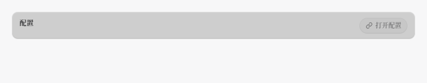
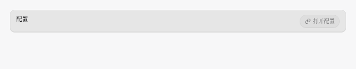
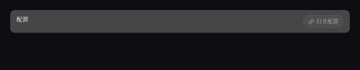
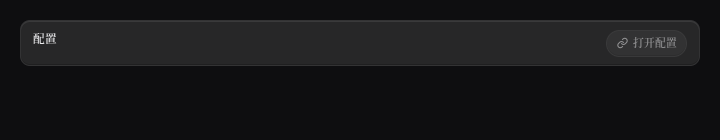

# P13-go 报告 · 设置页禁用 / 只读面的交接复核

执行者：Codex；起点 `ddc3ed19`（P13-gn）。工作树开盘为空，`git pull --ff-only origin mygo-rewrite` 已确认同步。
本轮限定设置表面的禁用 / 只读反馈；先完成交接 stash 清点。门槛与视觉数据随实测追加。

## 抢救 stash 清点（原始 ref，删除前记录）

实盘为 **9 条 stale-kill**，不是任务书所写的 8 条。其余 16 条 stash 不在本次删除范围。
六条 tracked patch 为空，但第三父含未跟踪测试，不能据空补丁直接删除。

| 原始 ref / SHA | 判断与证据 | 处置 |
|---|---|---|
| `stash@{0}` / `27f60e813d` | 空 tracked patch；`floatcorner_test.go` 是 P13-gm 草稿，以固定盒坐标读四角；HEAD 的 `1d991d41` 已用实际边界定位取代，并覆盖四角墨跨 | 已归档原件并 drop |
| `stash@{1}` / `d99fa84dfc` | 空 tracked patch；P13-gm 的 3× 角探针，以 alpha ≥190 找边。但左边压不透明设置卡，alpha 无法定位；HEAD 已修正为亮度阶跃定位、量四角 | 已归档原件并 drop |
| `stash@{2}` / `d0c564e8e5` | 空 tracked patch；`floatcorner_test.go` 与 `probe_gm_test.go` 是 P13-gm 角度扫描/定位日志，结论被同轮最终测试与 §6.158 覆盖，无产品改动 | 已归档原件并 drop |
| `stash@{3}` / `d4714ea77c` | 空 tracked patch；`floatside_test.go` 被 `c54dccac` 的 `floatvertical_test.go` 取代：取样从关闭按钮中线移至无字的 top+12，补候选侧边实测 | 已归档原件并 drop |
| `stash@{4}` / `d6522ac76d` | 空 tracked patch；下沿探针与不完整 `floatbottom_test.go` 被 `4a7b7506` 同名最终文件覆盖；旧左列 alpha 定位同样会误入不透明卡 | 已归档原件并 drop |
| `stash@{5}` / `cdc3ac6965` | 空 tracked patch；仅 `zzprobe_test.go` 的下沿像素日志，P13-gk / §6.156 已落地，未含产品改动 | 已归档原件并 drop |
| `stash@{8}` / `8a69c7f861` | reverse-check 失败（detach.go 注释/边高已改）；P13-fz `b601b6a9` 已接续并扩到便条，最终边高读共享常量。第三父旧规格误占 P13-ez 轮号，不覆盖正式规格 | 已归档原件并 drop |
| `stash@{9}` / `2cf8436498` | reverse-check 仅文档上下文失败；`git diff 2cf8436498 90a7e77b -- internal/settingsui/rows.go internal/settingsui/settingsui.go` 为空，生产改动逐字节已落地 P13-eu | 已归档原件并 drop |
| `stash@{10}` / `704b7643ba` | reverse-check 失败；与 P13-et `01e2bc35` 比较仅注释的旧绝对坐标不同，执行语句相同；第三父 `actionbar_band_test.go` 的算术/布局判据已收进 `actionbarbreath_test.go` | 已归档原件并 drop |

没有尚未接续的产品改动。旧探针含被最终测量方法推翻的假设，不能把它们重新覆盖到 HEAD。
为保留完整原件，删除前将每个对象写入本地 `refs/archive/floter/P13-go/<短SHA>`；第三父与原始补丁仍可用 Git 精确取回。

**处置已完成**：上述九条均已验证归档引用的完整 SHA 与原对象相等，再逐条 drop；stash 25 → 16，无 stale-kill 残留。没有需要另起接续 commit 的产品改动。

## 先量禁用胶囊（已实跑）

`TestDumpP13BARowLockedPill`：浅色地 247、启用面 230 / 冠 236、禁用面 238 / 冠 238 / 底 231；
深色地 14、启用面 39 / 冠 58、禁用面 26 / 冠 26 / 底 23。字墨对比的三通道和为浅 317 / 深 318。
因此 `rows.go:568–588` 这枚胶囊已经达成“一道淡、熄顶边、留底边”，不再重改。

同一设置表面的 `sessionKillConfirm`（`rows.go:1190–1194`）启用时用 `LitFace`，禁用时却只设 `Disabled`，
底部 `LensEdge` 随顶边一起被删掉。实测禁用面与底边相等：浅 RGB 245/239/234，深 28/23/23。
但 `settingsui.go:1739` 唯一产品调用始终传 `false`，这个禁用态不可达。**不把测试专属状态当成产品缺陷**；未改产品，临时探针已删除，原有测试函数保持。

## 基线环境差异（先诊断，不重钉断言）

默认执行环境 `LANG=zh_CN.UTF-8` 却有 `LC_ALL=C.UTF-8`，后者覆盖前者。`fc-match sans-serif` 取 Noto Sans；
`LC_ALL=zh_CN.UTF-8 fc-match sans-serif` 则取 Noto Sans CJK JP。旧 pin 的出货标题/正文行盒为 19/17，
默认环境读成 17/14，导致 HEAD 大批视觉测试红：第一遍 3271 PASS（不是历史声称的 3487）。
只恢复中文 locale 后，未改一字的 `TestTheTwoRulersAreNamedAndMeasured` 立刻 PASS。下面全量验证统一采用
`LC_ALL=zh_CN.UTF-8`，不设 `CI`，不跳过测试、不放宽断言。第二遍完整基线 **3487 PASS / 0 FAIL**，
与 HEAD 的历史数字吻合；原有测试函数 **2654**。

## 本轮实际缺口：工具自管配置入口

`configOpenToolRow` 的胶囊用 `openable` 禁用，但整行一直是 `rowFace{}`。缺命令和缺宿主回调两种情形，
en/zh × 深浅都复现：浅色行面 **230 → 206**，深色 **39 → 69**，与可用入口相同。
可用性表达在子胶囊和父行互相矛盾。采用既有 `rowFace.Inert`，把同一份 `openable` 接到行面，不改行为。

第一轮看图：禁用键很淡，但整条灰带依然被指针抬起，视觉重心落在不可用行上。
四视角：艺术总监——过宽反馈让不能操作的面抢重心；工程——父子未共用可用性；任务——键已灰但整行像可点；
读者——灰带改变文字周围的对比。第二轮只收掉这一处无意义的行面变化。

## 落地与前后图

`settingsui.go` 仅把 `openable` 移至行外并传入 `rowFace{Inert: !openable}`。标签与按钮盒逐值相同：
en 标签 `(33.6,29.10,501.9,18)`、按钮文字 `(573.40,34.5,104,17)`；zh 标签宽 561.9、按钮文字宽 44。
修复后不可用行浅色 **230 → 230 → 230**，深色 **39 → 39 → 39**；可用对照仍分别为 **230/206/223**、**39/69/50**。
按下探针落在行的空白内缩；标签列有独立 Clicked 目标，按在那里不能用来测父行的 Pressed 臂。

**这轮为什么让它更轻、更有空间感**：不可用入口留在卡片平面，去掉无意义的 24/30 级悬停台阶，把抬升反馈留给真正可操作的入口。

| 外观 | 改前（悬停不可用行） | 改后（同一位置） |
|---|---|---|
| 浅 |  |  |
| 深 |  |  |

原始 `ui.Tester` PNG：`/tmp/floter-P13-go-settings-{light,dark}-{before,after}.png`，720×140。
最终图另存 `/tmp/floter-P13-go-settings-{light,dark}.png`。已亲眼复核四张：浅色的整条深灰带退回浅卡面，
深色的亮灰条退回暗卡面；右端禁用胶囊仍可辨，文字与行位置未移动。仓库保留同一组图供复核。

## 偷了什么

- 从 `craft-loop.md` 工艺密度菜单 **第 12 项“材质细节”**取状态与深度一致：不可用入口悬停差从浅 **−24** / 深 **+30** 级收为 **0**，使用既有 `Inert`，不加新玻璃。
- **第 4 项“签名交互”**取 hover 揭示的用途：可用入口保留三个不同面，已有 `ColorStep=120ms` 不改；不可用入口三态同面。
- **第 6 项“编辑细节 / hairline”**取克制的边界：仍用原 **1px** 边，行盒 **44px** 地板与胶囊 **30u** 刻度不变；修复只关错误反馈。
- Apple 供体 `references/design-systems/apple/DESIGN.md` 的 **980px 胶囊 / 1px 边 / 400、600 字重角色**，转译为本仓既有半高半径胶囊、1px 边、按钮 600；没有照搬品牌色、纯黑或 Web blur。

采用已定方向的打磨路径，实际读了 SKILL、偏好账本、craft-loop、preflight、chinese-typography。
本轮只动一个可用性视觉条件，工艺项目为三项，未凑满五项；用户单表面和不加装饰的约束优先。

## preflight 逐条

| 项 | 结论 |
|---|---|
| A1 紫蓝渐变 / 纯黑 / 霓虹 / 渐变标题 | 通过：未引入；截图沿用 #F7F7F8 / #0E0E10 地面 |
| A2 非默认字体且与上轮不同 | 通用规则不采用：中文规则要求系统字体，本仓字体与高度契约优先；已核对 locale |
| A3 斜体 | 通过：无斜体 |
| A4 Hero 居中 | 不适用：设置配置行，无 Hero |
| A5 三等分卡片 / 万能卡片 | 通过：既有单行配置卡，无新增卡片 |
| A6 假名 / 假精确数据 | 通过：真实 i18n，测试夹具用 rg 命令，不生成营销数据 |
| A7 空词 / 感叹号 | 通过：界面文案未改，无新增感叹号 |
| A8 眉批 | 不适用：无眉批 |
| A9 H1 行数 | 不适用：无 H1 |
| A10 Bento 空洞 | 不适用：无网格 |
| A11 左侧选中色条 | 通过：无新增色条 |
| B1 设计读取与拨盘一致 | 通过：2/2/6，沿用紧凑桌面控件，只降低不可用面的反馈 |
| B2 单页主题 | 通过：深浅分别出图，未混色 |
| B3 记忆点 | 可操作入口才抬升；禁用胶囊和父行同一个答案 |
| B4 动效气质 | 通过：已有轻量颜色反馈，未加运动 |
| C1 目的 / 高频 | 通过：只处理指针状态；键盘路径未加动画 |
| C2 all / ease-in / scale(0) / 纯 fade | 通过：未新增这些动效 |
| C3 时长 / active | 通过：沿用 120ms；可用对照仍有按下档 |
| C4 origin | 不适用：无新浮层 |
| C5 reduced-motion | 测试使用 ReduceMotion=true，状态仍正确；既有全局兜底保留 |
| C6 hover 能力条件 | 本仓自绘，CSS media 不适用；仅沿用框架指针命中 |
| C7 transform/opacity、布局动画 | 未改动画属性或布局；行盒实测逐值相同 |
| C8 快速触发 | 沿用原颜色 transition；无新 keyframes |
| C9 手势 | 不适用：无拖拽、sheet、swipe |
| C10 Framer Motion | 不适用：Go 自绘 |
| C11 不确定动效抽查 | 无新动效；按真实 hover / 按下状态逐帧读像素并看截图 |
| D2-1 中文系统字体 | 通过：中文 locale 的系统 CJK 字体，无下载字体 |
| D2-2 行高 / ≥14px / 400、500、600 | **不能全过，沿用需拍板**：正文 10.8、Caption 9.9 与 ≥14 冲突；标签既有 580。本轮禁止改字阶和高度链 |
| D2-3 中西文 / 数字 / 单位空格 | 本轮无新 UI 文案；中文报告按此排版 |
| D2-4 标点 / 暗底 .85 与 ≥7:1 | 标点沿用既有；正常标签保留原主文字。禁用字仍为框架一次淡化，不能声称达到正文 7:1，继承禁用材质契约，不以新亮色改变可用性表达 |

## mutation（两条均实跑）

M1 `Inert: !openable → false`，进程 exit 1，8 个不可用组合变红。原始报错：

```text
configinert_test.go:64: light/en/no command: unavailable row changed face: rest={230 230 230 255 [0 0 0]} hover={206 206 206 255 [0 0 0]} pressed={223 223 223 255 [0 0 0]}
```

M2 `Inert: !openable → true`，进程 exit 1，4 个可用组合变红。原始报错：

```text
configinert_test.go:68: light/en: available row lost its distinct hover/press faces: {230 230 230 255 [0 0 0]} {230 230 230 255 [0 0 0]} {230 230 230 255 [0 0 0]}
```

每条之后分别还原，`md5sum -c` 输出 `internal/settingsui/settingsui.go: OK`，MD5 均为
`1c2e07a35d82c1eed7af53ef0b44dc28`；`touch` 后 `go test -count=1` 定向复跑两次均绿。

## 台账与门槛

V **0** / B **0** / S **0**：没有修改现有断言、没有改变行为或行结构；新增真实状态回归判据和 opt-in dump。
已完成：`gofmt -l cmd internal` 输出为空；linux / windows / darwin 的 `go vet ./...` 与 `go build ./...`
六道均 exit 0。最终 `go test -count=1 ./...` 串行复验与 `go test -count=1 -v ./...` 均 exit 0。
实测 **3488 PASS / 0 FAIL**（基线 3487，+1）；测试函数 **2656**（基线 2654，+2），
仅新增一个 opt-in 截图 dump 的 Skip，既有测试函数与断言均未删改。所有门槛均使用 `LC_ALL=zh_CN.UTF-8`。

详细全量已完成：**3488 PASS / 0 FAIL / 2656 测试函数**。并行执行的普通全量在既有
`TestAStaleMemoIsRefreshedBehindTheFrame` 出现一次 `integrationfacts_test.go:154: the pass left the memo marked pending`。
该测试没有被本轮修改，独立 `-count=20` 实跑全部通过；基线与详细全量也通过。不能据此认定根因已经修复，
将其列为待定位的时序不稳定；普通全量改为串行单独复验，不放宽断言、不跳过、不改会话或缓存语义。

## 仍待

当前轮已同时收完自管配置入口的“无命令 / 无宿主动作”两条原因。下一轮先定位上述 memo 偶发失败，
关闭门槛不稳定后，继续先量配置保存期间被锁住的字段外层行面。
原字号 / 行盒与终端持久化语义等需拍板项沿用；本轮无新增交互拍板项。
