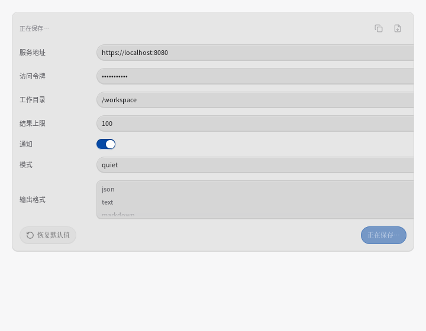
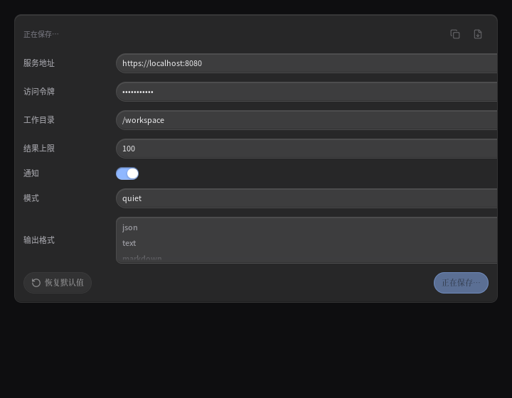
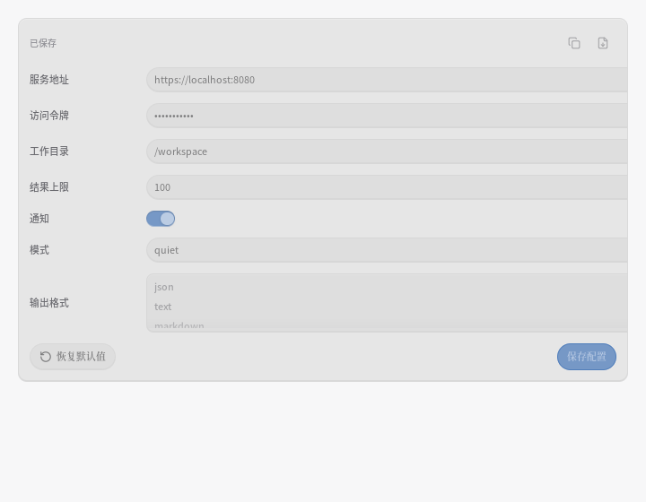
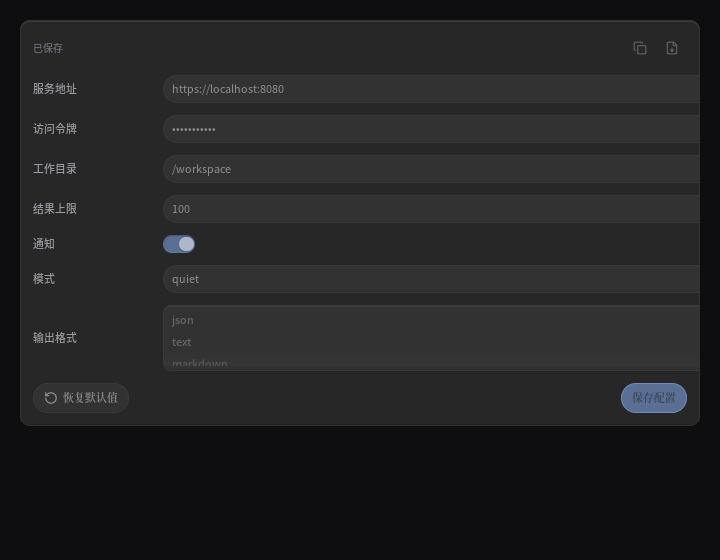

# P13-gp 报告 · 设置页后台刷新与保存中反馈

执行者 Codex；起点 `cfb17949`（P13-go）。pull 已同步，开盘工作树为空。
规格见 `P13-gp-spec.md`。按 qiaomu-design 打磨路径读取了 SKILL、偏好账本、craft-loop、
preflight、chinese-typography 以及 Apple 供体片段。没有切换模型、委派或生成风格选择页。

## 交接 stash 清点

实盘 **16 条 stash / 0 条 stale-kill**，P13-go 已完成任务书要求的清点，不能再 drop 漂移后的 ref。
本轮逐条核对本地归档引用，完整 SHA 与原件相符；沿用有证据的已回收结论，没有重试合。

| 原始 ref（P13-go 删除前）/ SHA | 判断 | 本轮处置 |
|---|---|---|
| `stash@{0}` / `27f60e813d` | P13-gm 四角最终测试覆盖 | 核对 archive 引用，已 drop，无需重做 |
| `stash@{1}` / `d99fa84dfc` | 同上，旧 alpha 定位探针被取代 | 同上 |
| `stash@{2}` / `d0c564e8e5` | 四角草稿/探针，无独有产品改动 | 同上 |
| `stash@{3}` / `d4714ea77c` | P13-gl 侧边测试覆盖 | 同上 |
| `stash@{4}` / `d6522ac76d` | P13-gk 下沿测试覆盖 | 同上 |
| `stash@{5}` / `cdc3ac6965` | P13-gk 下沿探针覆盖 | 同上 |
| `stash@{8}` / `8a69c7f861` | P13-fz 已接续 detach 并扩到便条 | 同上 |
| `stash@{9}` / `2cf8436498` | P13-eu 产品字节相同 | 同上 |
| `stash@{10}` / `704b7643ba` | P13-et 产品语句及最终量尺覆盖 | 同上 |

原件在 `refs/archive/floter/P13-go/<短 SHA>`；详证见 P13-go 报告。其余 16 条保留，
没有新的 stale-kill 或需要单独接续的工作。开盘 `~/.hermes/state/iteration/floter-done.log` 不存在，收尾创建。

## 已定位的门槛不稳定

旧测试传入 `now + TTL`，而 worker 发布真实 `time.Now()`。如果 worker 先于第二个请求完成，
第二个请求读到的完成时间仍落后一个 TTL，于是重复启动，旧测试看到 `pending=true`。
这是两套时钟混用，可用「等待发布 → 同一个模拟时刻再请求」确定性重现，不靠全量重试赌通过。
现有行为断言不修改；修复保留计算完成后再起算两秒 TTL。

## 保存中字段的代码事实

`configFieldGrid` 是透明网格，本来没有悬停/按下换面；上一轮对它的怀疑需要用真实帧证伪。
本轮先导出图片、量像素，再决定是否需要视觉改动。

新 pin 在原产品代码上已确定性变红（exit 1）：

```text
integrationfactsclock_test.go:39: completion clock 2026-11-05 00:15:02.90590318 +0800 CST m=+0.003706940 must follow request clock 2026-11-05 01:15:02.905703293 +0800 CST m=+3600.003507004, including elapsed computation
integrationfactsclock_test.go:47: the same frame clock started another refresh after publication
```

进一步实读纠正了上一轮的前提：`configLocked` 只读 `rowBusy`，后者只有 repair/disable/remove/
uninstall/toggle，**不含 `configSaveBusy`**。保存仅锁动作胶囊，不能把「保存中」当成「字段锁定」。
因此图与判据分开覆盖 saving 和 toggleBusy 两种真实状态；是否让保存锁字段属于交互/写回拍板项，
本轮不擅自实施。

## 基线与改前实测

未改产品时的全量基线 **3488 PASS / 0 FAIL / 2656 测试函数**，exit 0，日志
`/tmp/floter-P13-gp-baseline.log`。新回归 pin 单独运行在旧实现上红，未混进基线。

7 种字段 × en/zh × 深浅 × idle/saving/toggleBusy，共 **84 组**，指针移入与按下均零面差：
浅色列间面三态 RGB **230/230/230**，深色 **39/39/40**。列间取样 x=157，位于 118px 标签列后的
12px 间隔中；标签 x=33，第一行 y=80.5，盒高 17；最后多选标签 y=329.5。行盒逐值不变。
这证明它本来就是静息网格，不应为追求改动量再补一套 Inert 或禁用色。

## mutation（已实跑并还原）

| 编号 | 注入缺陷 | exit / 结果 |
|---|---|---|
| M1 | 后台发布改回 `time.Now()` | 1；时钟与重复刷新两条判据红 |
| M2 | 发布只用请求 `now`，不加耗时 | 1；完成时间判据红 |
| M3 | `configFieldGrid` 临时加入 `Hovered → SurfaceHover` | 1；84 组全部红 |

M1 原始报错：

```text
integrationfactsclock_test.go:39: completion clock 2026-11-05 00:19:09.152447821 +0800 CST m=+0.002460240 must follow request clock 2026-11-05 01:19:09.152388396 +0800 CST m=+3600.002400813, including elapsed computation
integrationfactsclock_test.go:47: the same frame clock started another refresh after publication
```

M2 原始报错：

```text
integrationfactsclock_test.go:39: completion clock 2026-11-05 01:19:53.934848895 +0800 CST m=+3600.002582807 must follow request clock 2026-11-05 01:19:53.934848895 +0800 CST m=+3600.002582807, including elapsed computation
```

M3 原始报错：

```text
configgridquiet_test.go:91: light/en/idle/text: grid changed face: rest={230 230 230 255 [0 0 0]} hover={206 206 206 255 [0 0 0]} pressed={206 206 206 255 [0 0 0]}
```

每条还原后 `md5sum -c /tmp/floter-P13-gp-restore.md5` 两文件均 OK，再 touch 对应文件，
定向 `-count=1` 通过。旧偶发测试与新 pin 共同 `-count=20` 通过；没有改旧行为断言。

恢复后的 MD5：`integrationfacts.go` 为 `2f86e6f815474f3f6d05090c61174707`，
`config.go` 为 `668eece677042165dab834cf6bb769e1`。

## 图与两轮复核

| 状态 | 浅色前 / 后 | 深色前 / 后 |
|---|---|---|
| 保存中 |   |   |
| 行操作锁定 |   |   |

原始 `ui.Tester` PNG：`/tmp/floter-P13-gp-settings-{light,dark}-{saving,locked}-{before,after}.png`，
720×560；四对 `cmp` 全相同。这一张图上看到的**状态变化**是：保存中字段顶边仍亮，toggleBusy 时
同一边熄灭、控件面变淡，外层标签不随之变淡；**本轮改前/改后没有像素变化**。
测试取真实 configFields 构造器，不包含窗口壳/侧栏，不声称是真机整页截图。

四视角复核：艺术——只让控件变淡，外层没有额外灰带，方向成立；工程——右端控件被卡边裁掉，
还需完整集成页定位；任务——“保存中”与“字段不可编辑”不是同一个状态，不能误改；读者——
9.9/10.8px 字阶偏小，仍属于既有拍板项。第二轮完成计时修复后重拍，确认未改变已成立的网格材质。
没有为满足工艺项数给静息网格加装饰。

4× 局部也已复核：[浅色](P13-gp/settings-light-detail.png) / [深色](P13-gp/settings-dark-detail.png)。
标签笔画与字段的淡化层次不同，列间没有新增高亮带；它们仅是同一真实 PNG 的无插值放大。

**为什么更轻、更有空间感**：84 组证据守住外层 0 级面差，把反馈留给控件；计时链不再把刚完成的
结果当成过期结果。当前像素本来满足这条要求，本轮不宣称通过测试让它“看起来更新”。

## 偷了什么

- 从 `craft-loop.md` 菜单 **第 12 项（材质细节）**取层次有归属：字段网格的三态面差钉成 **0**，
  与浅 230 / 深 39 的卡面一致，禁用材质只落在控件。没有新透明度或高光。
- **第 4 项（签名交互）**取反馈只服务动作：用实际指针 hover/press 验证，沿用 **120ms** 颜色刻度，
  探针推进 **300ms** 后读稳定帧；M3 临时增加反馈使 **84/84** 组红。
- **第 6 项（编辑细节）**取明确的列与细边：保留 **118px** 标签列、**12px** 列间距、**1px** 控件边；
  取样在列间 x=157，几何守卫精确比较盒子，无放宽容差。
- Apple 供体抽取近白/近黑、交互色单职、1px 边三个规则；转译到既有 **#F7F7F8 / #0E0E10**、
  accent 预算、1px token 边，未照搬其网页字体或纯黑背景。

本轮按单表面纪律只应用三项工艺，未凑满五项；两轮实图优先于装饰数量。用户已指定轻便液态玻璃，
不执行四方向选择。字号与布局问题据实记录，不能假称整个 preflight 全绿。

## preflight A / B / C / D2 逐条

| 项 | 结论 |
|---|---|
| A1 紫蓝渐变 / 纯黑 / 霓虹 / 渐变字 | 通过；沿用中性两套主题 |
| A2 非系统字体且每轮更换 | 不采用；本仓中文系统字体与高度契约优先 |
| A3 斜体 | 通过；无斜体 |
| A4 Hero 居中 | 不适用；设置配置表单 |
| A5 三等分卡片 / 万能卡片 | 通过；没有新增卡片 |
| A6 假名 / 假精确数字 | 通过；图为真实构造器测试数据，不宣称实测业务数据 |
| A7 空词 / 感叹号 | 通过；无新增 UI 文案 |
| A8 眉批 | 不适用；无眉批 |
| A9 H1 行数 | 不适用；无 H1 |
| A10 空洞网格 | 通过；每一行均为标签/控件；右端裁切另列仍待，不假称无溢出 |
| A11 左侧选中色条 | 通过；无新增色条 |
| B1 读取 / 拨盘一致 | 通过；2/2/6，既有紧凑表单，限制视觉变动 |
| B2 一页一个明暗主题 | 通过；深浅独立截图 |
| B3 一句话记忆点 | 外层静息，控件自己表达可用性 |
| B4 动效与气质一致 | 通过；没有新增动效 |
| C1 目的 / 高频 | 通过；没有新增高频/键盘动画 |
| C2 all / ease-in / scale(0) / 纯 fade | 通过；没有引入 |
| C3 ≤300ms / active | 沿用 120ms；三态实际采样，静息网格无 active 变化属预期 |
| C4 浮层 origin | 不适用；没有新增浮层 |
| C5 reduced-motion | 通过；84 组以 ReduceMotion=true 运行 |
| C6 hover 媒体条件 | CSS 条件不适用 Go 自绘；使用框架真实指针命中 |
| C7 动画属性 / 布局动画 | 通过；未动动画属性或布局，标签盒逐值比较 |
| C8 快速触发 | 没有重播 keyframes，沿用原过渡 |
| C9 手势 | 不适用；无手势修改 |
| C10 Framer Motion | 不适用；Go 自绘 |
| C11 不确定动效抽查 | 无新动效；hover/press 稳态帧实测，不声称做过真机逐帧动画验收 |
| D2-1 中文系统字体 | 通过；中文 locale，无下载字体 |
| D2-2 行高 / ≥14px / 400、500、600 | **未全过，沿用需拍板**：正文 10.8 / Caption 9.9 与 ≥14 冲突，不改变高度链 |
| D2-3 中西文与单位空格 | 无新 UI 文案；夹具字段名分别使用中文或英文 |
| D2-4 标点 / 暗底 .85 / ≥7:1 | 标点正常；禁用字不承诺正文 7:1，继续既有一次淡化契约，未伪报对比度 |

## 门槛（最终）

gofmt 输出为空；linux/windows/darwin 的 vet 和 build 六道均 exit 0。测试函数实测 **2659**
（基线 2656，+3，含一个明确 opt-in 的截图 dump）。V **0** / B **0** / S **0**，既有测试文件零改。
普通 `go test -count=1 ./...` 与详细 `go test -count=1 -v ./...` 均 exit 0。
最终实测 **3490 PASS / 0 FAIL**（基线 3488，+2）；测试函数 **2659**（基线 2656，+3）。
唯一新增 Skip 是明确 opt-in 的 PNG dump；既有测试函数、断言及容差均未删改。
日志在 `/tmp/floter-P13-gp-{test,verbose}.log`；三平台 vet/build 日志使用同一前缀。
完整串行普通/详细两遍均包含原来的偶发测试。该根因结论来自确定性复现与 M1，非仅凭复跑通过。

## 仍待

1. 下轮首选配置表单右端裁切：先在完整集成页复现，再量控件/网格/卡盒宽。本轮图只能证明组件夹具
   里的裁切，不直接等同于整页产品缺陷；与外层状态面独立，不在本轮顺手改布局。
2. §6.161 的 161-4：保存是否锁字段，必须连同保存期间新输入的归属一起决定；未改编辑/写回语义。
3. 字号、36px 行盒和终端 S1b/S1c/S2 尾等既有拍板项保留；不重复领取已落地的胶囊/受光边/Float。
