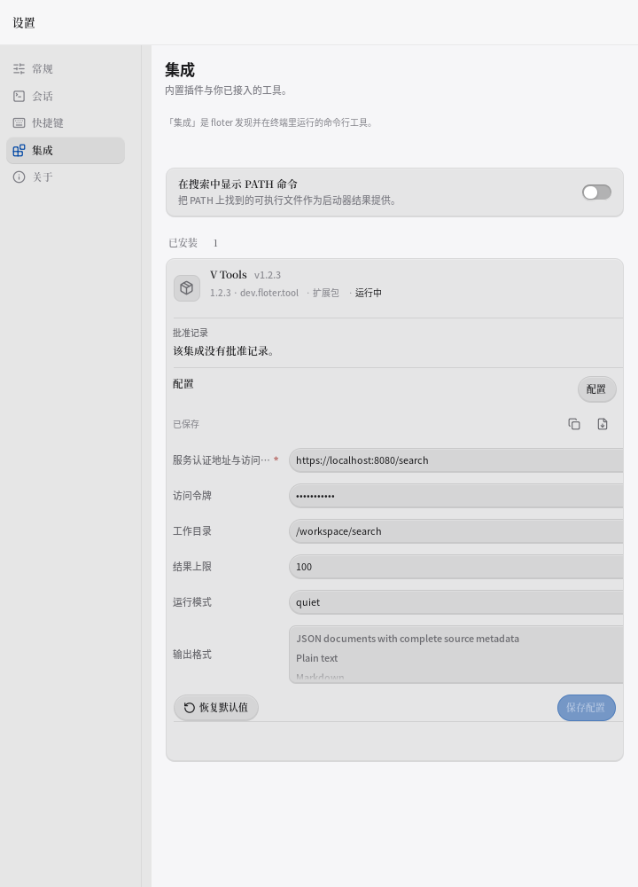
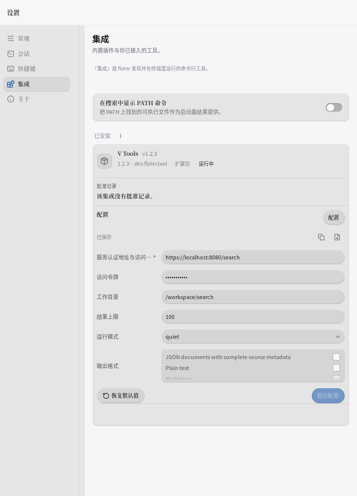
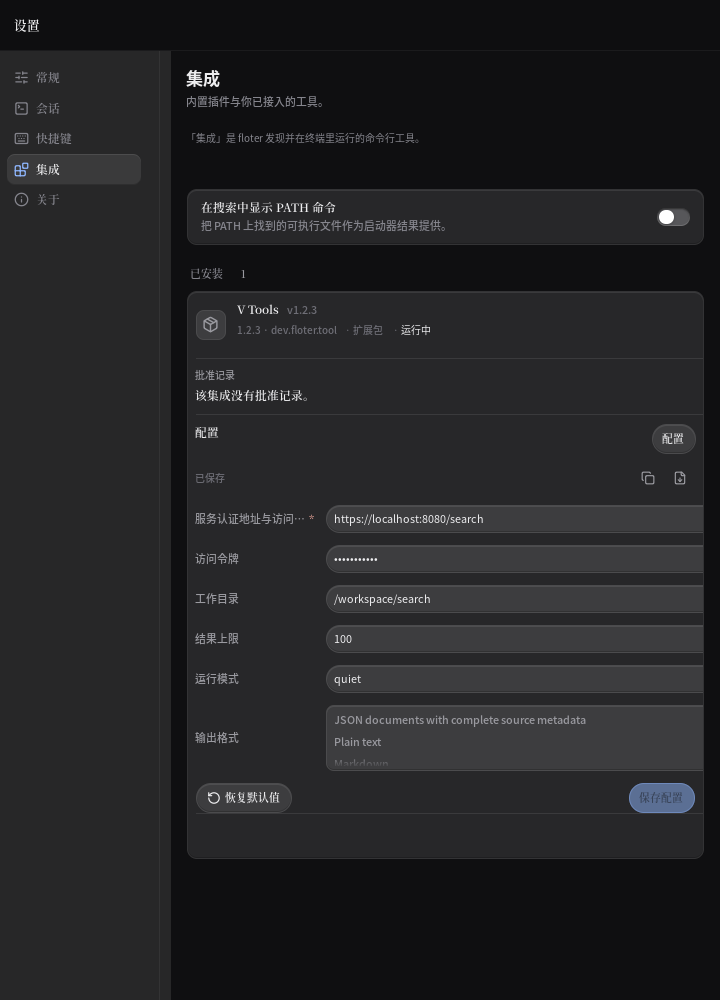
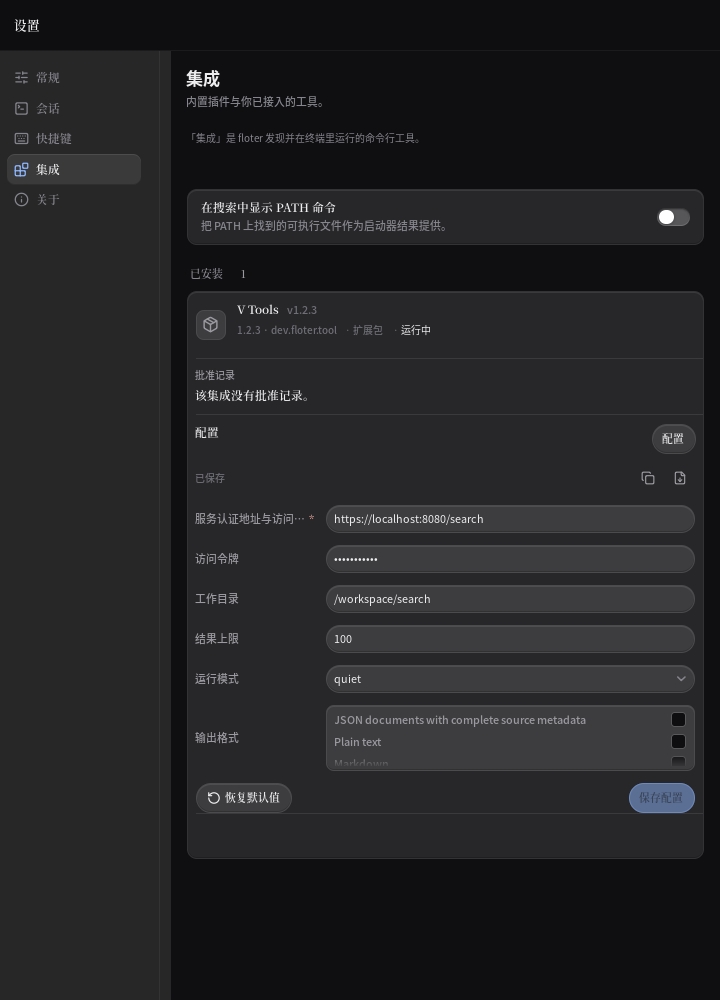
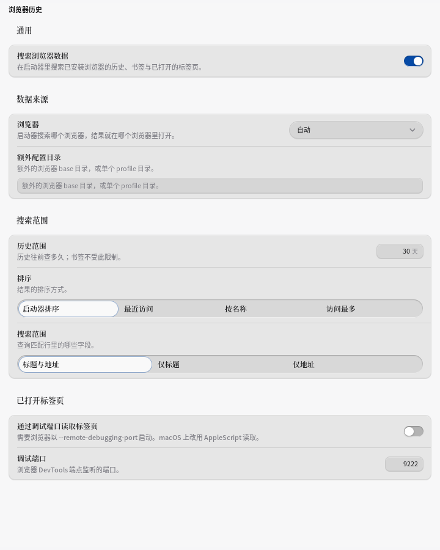
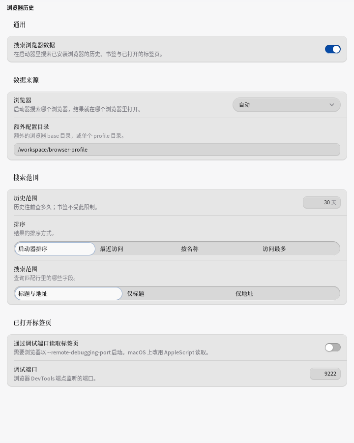
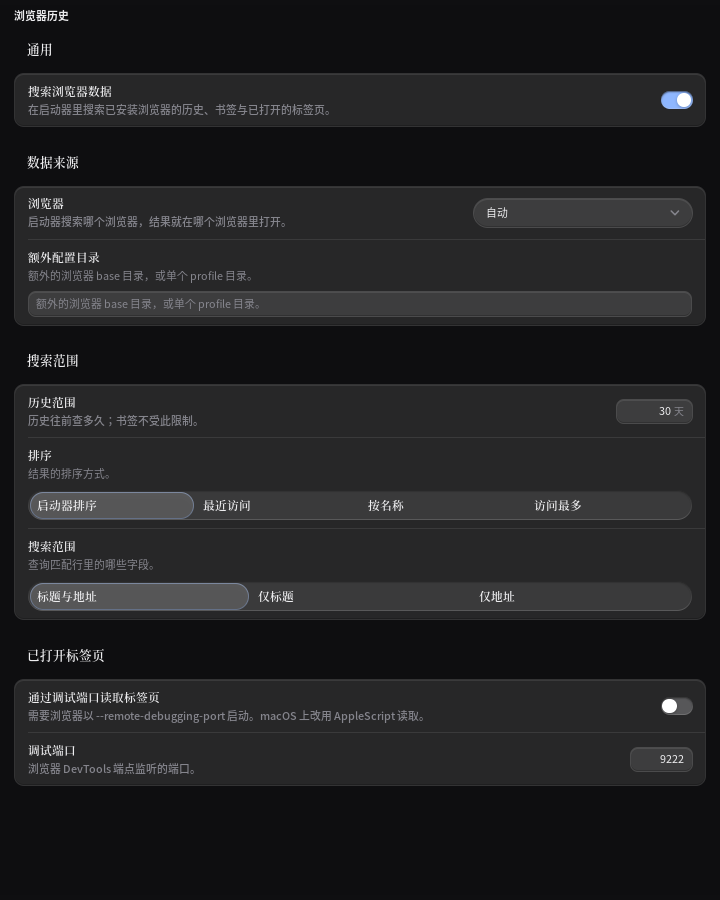
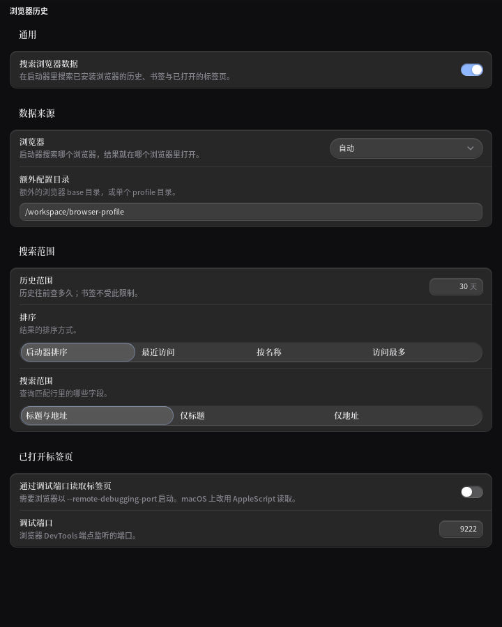

# P13-gq 报告 · 配置表单边界与输入接线

执行者 Codex；起点 `066092ea`，pull 已同步，开盘工作树为空。
实测基线 3490 PASS / 0 FAIL / 2661 个 `func Test`，日志 `/tmp/floter-P13-gq/baseline.log`。
本轮采用 qiaomu-design 已有方向打磨路径，规格见 `P13-gq-spec.md`。

## 交接清点（已核对）

指定的 stale-kill 抢救项已在 P13-go 归档并 drop；九个 archive 引用仍在。
本轮实盘 16 条历史 stash，0 条 stale-kill。对 16 条均保存 tracked patch 并实跑 reverse-check：
前三条只有 untracked 探针，其余 13 条上下文已漂移，不能据失败误认独有产品工作。
逐条最终处置表随证据追加；不静默丢弃、不重合已回收工作。

## 先量

mygo 网格用整个网格的 cw 解析直接子项百分比；配置字段却是 118px + 12px + 剩余宽两列。
文本提交查询外层行容器，而框架 Submitted 只报告本元素的输入状态，事件不冒泡。
尚未把候选缺陷写成已修；接下来用真实控件/键盘与深浅截图确认。

第一轮旧代码回归实跑 exit 1，日志 `/tmp/floter-P13-gq/before.log`：

- 三种控件盒均 x=150、宽 480，右界 630；可用列是 [150,500]，越界 **130px**。
- 长选项文字盒 192×68，右端点击没有改变勾选值；勾选框被文字挤掉。
- 恢复默认后仍显示 `a number is expected`。
- 插件文本 Enter 后回调为空。
- 集成数字 NaN/Inf 在 en/zh 都得到空错误文案；插件 NaN 直接派发，Inf 被错误写成最大天数 **3650**，-Inf 写成 **0**。
- 长必填标签与星号原本已正确，测试通过，**不改产品、不计修复项**。

已亲眼看过完整 720×1000 集成页深浅 before：四枚输入框和下拉的右圆角都被卡边切掉，
下拉箭头、多选勾选框完全不可见。截图取完整 App.View，不再用组件夹具代替整页证据。

第一轮改后复核进一步定位两个根因，已据此纠正实现：

- 多选并非只是长文本挤压。`ui.CheckboxBase` 是**无尺寸、无绘制**的基础控件，旧代码没有给它任何子元素，
  所有选项的勾选框都是 0×0；恢复现有 `ui.Checkbox` 的外观和命中区，再限制长选项宽度。
- 文本 Enter 接通后，回调收到了空串；文本草稿每帧都从已存值重新初始化，用户刚输入的内容也会丢。
  使用与既有数字草稿同样的局部状态保存未提交文本，按插件 ID + 字段键隔离；Enter 仍是唯一提交动作。

## 七项交付（逐项现象 → 改动 → 验证）

1. **字段右端被裁切** → 为第二列增加无材质的列容器，让 FillWidth 相对于字段列解析 →
   text/select/multiselect 从 `(150,20,480,28/66)` 改成右界精确 **500**，宽 **350**，消除 **130px** 越界；
   完整集成页的输入右圆角与下拉箭头重新可见，标签列 118px / 间隔 12px / 字段高度保持。
2. **多选列表没有勾选框，无法辨认选中状态** → 无绘制的 CheckboxBase 改为现有 Checkbox，
   文字可缩且换行，框保持尺寸 → 右端点击真的切换值；深浅选中前后框区有超过 100px 的颜色变化；
   锁定后点击和 Space 均不改值。长选项也保有可点的右侧框。
3. **浏览器额外配置目录按 Enter 无法提交，输入跨帧丢失** → 返回输入本体以承接 Label/Submitted，
   增加按插件 ID + 字段键隔离的局部文本草稿 → 输入后普通帧不提交、Enter 恰好回调一次，
   再重绘不重复；关闭重建表单后显示已确认的 `/workspace/browser-profile`，旧实现重开为空。
4. **集成数字接受 NaN/Inf，保存前没有字段错误** → ParseFloat 后拒绝非有限数，复用既有 ConfigNumber 文案，
   保留用户原输入但不把非法数放进值图 → en/zh 覆盖 NaN/nan/Inf/+Inf/-Inf/Infinity/1e999；
   真键盘输入 NaN/Inf 显示错误且 draft.values 为 nil，再输入 12.5 错误消失并恢复数值。
5. **恢复默认后还挂着旧字段错误** → 只清除有默认值且本次被恢复字段的旧错误 → 默认数字 3 回到草稿，
   `a number is expected` 消失；没有默认值的另一字段保留原错误，恢复动作没有触发保存回调。
6. **插件数字 NaN 被派发，Inf/-Inf 被写成上限/下限** → 数字控件解析后先检查有限性，再走原有钳位回调 →
   NaN/Inf/-Inf 均不派发；原实现分别派发 NaN/3650/0；接着输入 45 正常回调，已有有限数范围规则不变。
7. **插件保存失败后，提示句插入导致输入失焦、无法直接重试** → 给现有字段分组稳定的 key，
   提交后保留仍聚焦的草稿，失焦才读取宿主确认值 → 拒绝首次写入、显示真实失败句后，
   输入仍聚焦；再次 Enter 回调携带原路径。第二轮曾实测仅有一次回调，修复后两次同值。

两个组件：集成配置 `config.go` 与通用插件配置 `pluginsheet.go`，复用既有状态字段所在的 App。
没有新增页面、依赖、主题 token、全局输入模型或会话语义。保存期间是否锁字段仍按 §6.161 保留。

## 变异（八条实跑）

| 编号 | 注入缺陷 | 原始失败串（节录） | 结果 |
|---|---|---|---|
| M1 | 移除字段列容器，恢复直接 FillWidth | `text control={150 20 480 28}; want second column [150,500], not the whole grid width` | exit 1，三类均红 |
| M2 | helper 返回装饰 slot 而不是输入 | `the text editor did not take focus` | exit 1，接线判据红 |
| M3 | 恢复无绘制 CheckboxBase | `visible trailing checkbox was not clickable: on=false changed=false word={10 10 192 68}` | exit 1，点击与状态像素测试均红 |
| M4 | 不清除已恢复字段的错误 | `restored number still reports its old error: "a number is expected"` | exit 1 |
| M5 | validator 不检查非有限数 | `en accepted non-finite input "NaN": value=NaN problem=""` | exit 1，en/zh 各六种红 |
| M6 | 插件数字恢复只判断 parse 成功 | `invalid number reached the plugin callback: [{history_days 3650}]` | exit 1，NaN/+Inf/-Inf 三种红 |
| M7 | 去掉字段分组的稳定 key | `the failure sentence replaced the focused input` | exit 1，错误反馈出现即丢焦点 |
| M8 | 提交后立即删除聚焦草稿 | `retry lost the rejected edit: [{custom_base_dir /workspace/browser-profile} {custom_base_dir }]` | exit 1，重试变成空串 |

每条均还原后 `md5sum -c` 三文件 OK，touch 受影响文件，再 `-count=1` 定向复验 exit 0。
M2 首次注入导致 input 未使用的编译错误，**不计有效变异**；补 `_ = input` 后重新实跑以上行为失败。
原日志 `/tmp/floter-P13-gq/M1.log` 至 `M8.log`；M1–M6 恢复日志同名前缀加 `-restored.log`，
M7/M8 的 MD5 与 touch 后复验输出在本轮执行记录中。
M1–M6 恢复时产品 MD5：config.go `4e87bfb121aab50d914cdef91cdb5dd9`；pluginsheet.go
`3c0010604c171e982c7c5b5312fbacdf`；settingsui.go `75ab2de74d88e7824b8f85a4861bda7f`。
第二轮失败重试修复后的最终 pluginsheet.go 为 `fd4d0052dd50014c2ff5806684fb6b59`；
M7/M8 使用更新后的清单逐字节还原，其他两个产品文件 MD5 不变。

## 抢救 stash 最终处置表

下表 ref 均为**开盘编号**，使用 SHA 核对后才删除。前八条原件先写入
`refs/archive/floter/P13-gq/<完整 SHA>`，核对对象相同后 drop；完整第三父探针仍可恢复。

| 开盘 ref / SHA | 判断 | 处置 |
|---|---|---|
| 0 / `6fab9677` | 无 tracked patch，仅 palette 探针；现有 palettefloor/ceiling/pair 系列与其后报告覆盖测量 | 归档并 drop |
| 1 / `a278f75d` | 无 tracked patch，仅 P13-fb 终端字体探针；任务书已结案 | 归档并 drop |
| 2 / `33e03d1f` | 无 tracked patch，仅 P13-bq 行刻度探针；`8804f992` 已落地 | 归档并 drop |
| 3 / `afc38b24` | P13-af 未完成 metaSeparator 草稿；P13-af 报告明确接续为 RichText，旧透明占位方案已被取代 | 归档并 drop |
| 4 / `114b7d15` | 只有 P13-ad pending 记录；报告与合约已收录同一轮结果 | 归档并 drop |
| 5 / `df5647ed` | P13-x 的 headingRects/outputHeadingRects；`4783c62d` 与报告明确已完整接续 | 归档并 drop |
| 6 / `567cf0a9` | 与上一条同产品 patch，另含已落地规格和量尺 | 归档并 drop |
| 7 / `407ed84a` | P11-cq 的设置快照优化；`f4e1fb87` 已落地，P13-x 报告明确 P12-a 已结案 | 归档并 drop |
| 8 / `422483b4` | P7-lg keycap / 旧主题 WIP，reverse-check 不通过，非 stale-kill | 保留原 stash，未将旧主题覆盖新合约 |
| 9 / `8af94a07` | P7-hd 前行距/滚动边 WIP，reverse-check 不通过 | 保留原 stash；现行行距另有正式 pin |
| 10 / `7e4aa710` | P7-gv 卸载布局与 scratch 测试 WIP，reverse-check 不通过 | 保留原 stash；未覆盖现有卸载弹层 |
| 11 / `1e3aec94` | P7-gv 数字控件草稿/旧透镜材质，reverse-check 不通过 | 保留原 stash |
| 12 / `363f5a42` | P7 确认带/快捷键 WIP，reverse-check 不通过 | 保留原 stash |
| 13 / `9b8ce23c` | P7 自定义快捷键拒绝反馈 WIP，reverse-check 不通过 | 保留原 stash |
| 14 / `90d314b2` | 旧启动器 action bar WIP，现行键盘模型已有后续用户决策 | 保留原 stash |
| 15 / `7a9f6e13` | 旧 main 的 Tauri release workflow；该路径在当前 Go 分支不存在 | 保留原 stash，未重新引入旧发布链 |

实盘 **16 → 8**，stale-kill 始终为 0；八个已结案残留已移出有效 stash 队列。
其余八条是早期独立 WIP，不据 reverse-check 失败武断丢弃，也不声称已完成内容接续。

## 前后图与两轮复核

| 组件 | 浅色前 / 后 | 深色前 / 后 |
|---|---|---|
| 集成配置 |   |   |
| 插件目录提交后重开 |   |   |

集成页 720×1000，插件页 720×900。都是 ui.Tester 实际渲染，不是系统窗口截图。
插件 before 用同一驱动恢复旧文本实现拍摄，随后逐字节校验恢复产品。最终标准 PNG 同时放在
`/tmp/floter-P13-gq-<settings|plugin>-<light|dark>.png`。

第一轮四视角：艺术——字段面延伸到卡边，没有右侧空气；工程——箭头和勾选框缺失；
任务——目录输入没有落到已有保存回调；读者——多选状态不可辨认，字号仍属于既有拍板项。
第二轮只修上述同族问题。亲眼复核：输入右圆角和箭头完整出现，右端 Checkbox 可见；
插件目录前图为空，后图重开仍保留输入值。另存 4× 无插值局部图核对边界。

**为什么更轻、更有空间感**：消除越界让字段与卡边重新留出空气，既有 1px 边终于能完整收口；
选中状态由控件自己的小面积反馈表达，未增加灰带、投影或第二层玻璃。

## 偷了什么

- `craft-loop.md` 菜单 **第 6 项（编辑细节）**：固定 **118px** 标签列、**12px** 列间距；
  控件实测从 **480px → 350px**，把多吃的 130px 还给布局边界。
- **第 12 项（材质细节）**：保留 **1px** 边与原 **28px / 66px** 高度，恢复右圆角闭合；
  材质 token 不改，也不靠裁切或额外描边掩盖宽度错误。
- **第 3 项（品牌 focus 环）**：让输入本体拥有 Label/焦点；Checkbox 使用原生 **Space(4)**
  尺寸（默认主题 14.4px）与现有 focus treatment，恢复可见命中区，不再用 0×0 占位。
- Apple 供体的 **1px 边、单一交互色、980px 胶囊语义**分别落到既有 ControlEdge、Accent 和
  半高胶囊；没有复制纯黑、网页字体或模糊材质。工艺三项已足以服务修复，按两轮制优先原则不凑装饰五项。

## preflight A / B / C / D2

| 项 | 结论 |
|---|---|
| A1 渐变 / 纯黑 / 霓虹 / 渐变字 | 通过；没有新增，沿用两套语义主题 |
| A2 每轮换非系统字体 | 不采用；中文系统字体与既有高度契约优先，统一中文 locale |
| A3 斜体 | 通过；无 |
| A4 Hero 居中 | 不适用；原生配置表单 |
| A5 三等分 / 万能卡片 | 通过；只加无材质的列容器，不新增卡片 |
| A6 假名 / 假数字 | 通过；截图是可执行夹具，未当业务统计 |
| A7 空词 / 感叹号 | 通过；未新增产品文案 |
| A8 眉批 | 不适用 |
| A9 H1 行数 | 不适用 |
| A10 网格空洞 / 溢出 | 通过；字段列精确右界守卫，完整页看图 |
| A11 左侧装饰色条 | 通过；未新增 |
| B1 读取 / 拨盘 | 通过；2/2/6，修复既有配置功能 |
| B2 主题一致 | 通过；深浅分别渲染 |
| B3 记忆点 | 完整字段边界、可见选择、输入可落地 |
| B4 动效与气质 | 通过；没有新增动效 |
| C1 动效目的 / 频率 | 通过；键盘提交不加动画 |
| C2 all / ease-in / scale(0) / fade | 通过；没有引入 |
| C3 ≤300ms / active | 通过；沿用既有 120ms 与控件反馈 |
| C4 弹出 origin | 不适用；下拉实现原样保留 |
| C5 reduced-motion | 通过；整页截图使用 ReduceMotion，未新增动效 |
| C6 hover 媒体查询 | Web 查询不适用于 Go 自绘；沿用框架指针事件 |
| C7 属性 / 布局动画 | 通过；未加入布局动画 |
| C8 快速触发 | 通过；Enter 不重复提交，无新增 keyframes |
| C9 手势 / 拖拽 | 不适用 |
| C10 Framer Motion | 不适用 |
| C11 慢放 / 真机 | 无新动效；没有声称做过真机动画验收 |
| D2-1 中文系统字体 | 通过；无下载字体 |
| D2-2 行高 / ≥14px / 字重 | **沿用需拍板**：现有正文 10.8px、Caption 9.9px，未擅自改变高度链 |
| D2-3 中西文 / 单位空格 | 无新增产品文案；沿用 i18n |
| D2-4 标点 / 暗色对比 | 标点未改；禁用墨不承诺正文 7:1，继续既有一次淡化规则 |

## 门槛与仍待

**最终门槛（由接手本轮的 pi 在 `066092ea` 之上实测补录）**：`gofmt -l cmd internal` 输出 0 字节；
`go vet ./...` 与 `GOOS=windows|darwin go vet ./...` 三平台均净；三平台 `go build ./...` 全过；
`go test -count=1 ./...` **exit 0**（44 包 ok，无 FAIL）；`go test -count=1 -v ./...` 计 **3506 PASS / 0 FAIL**
（`--- FAIL` 计 0），`func Test` 计 **2671**。P13-gp 基线为 3490 PASS / 2659 函数，本轮 +16 PASS / +12 函数
（新增 `configboundary_test.go`、`plugininput_test.go` 两个测试文件）。既有测试零改，V/B/S 断言重定基线均为 0。
第一次设置包全量通过（480.344s）。发现失败重试问题后增加第七项并重跑最终全量，
不拿修复前的通过结果冒充最终源码验证。

**交接说明**：本轮由前一位执行者完成后未及提交即被中断，工作树整体进了抢救 stash
（`9213c7f0` 等四条，最完整的一条为 `stash@{0}`）。接手者 `git checkout stash@{0} -- .` 回收全部改动，
逐字节核对三个产品文件 MD5（`pluginsheet.go fd4d0052…`、`config.go 4e87bfb1…`、`settingsui.go 75ab2de7…`
与报告记录一致），四条过程 stash 归档到 `refs/archive/floter/P13-gq/<sha>` 后 drop，`git stash list` 由 12 回到 8。
仍待：保存期间字段锁定与写回归属（§6.161-4）、字号和终端持久化拍板项继续保留。
下一轮选题：真实集成配置里「错误 → 修改 → 恢复 → 关闭」的状态组合。具体线索：
`configActions` 仍在恢复默认时调用 `draft.clearLive()` 清全部输入，而默认值只覆盖有 Default 的字段；
无默认值数字的半输入（如 `1e`）是否被连带清除，下一轮先实测，不把静态推断计作已修。
本轮已进入调用预算收尾，余项按任务书要求落盘；
本轮七项不留下半修复。历史八条非抢救 WIP 原件继续保留，详细语义合并不与本轮配置修复混做。
