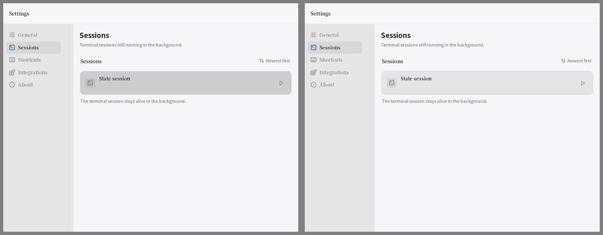
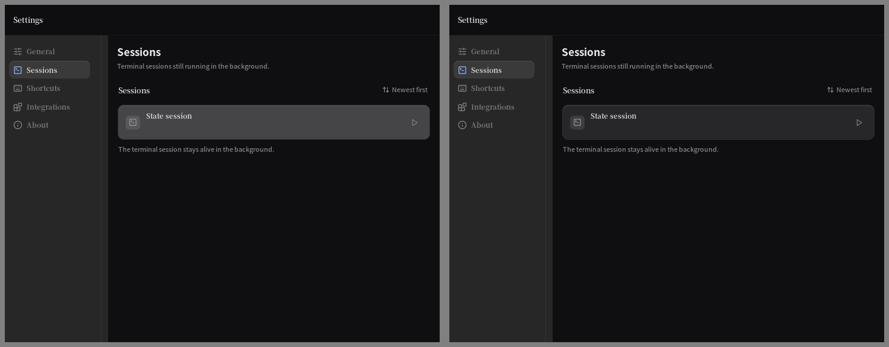
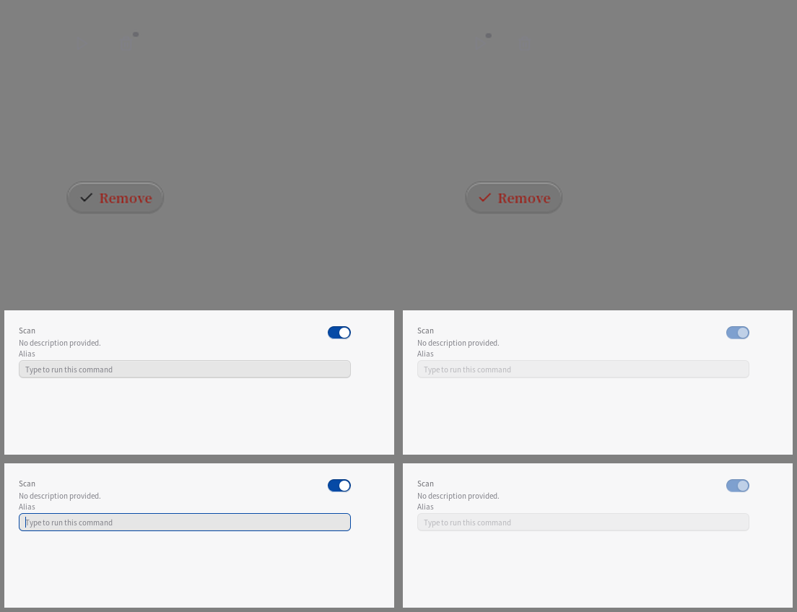
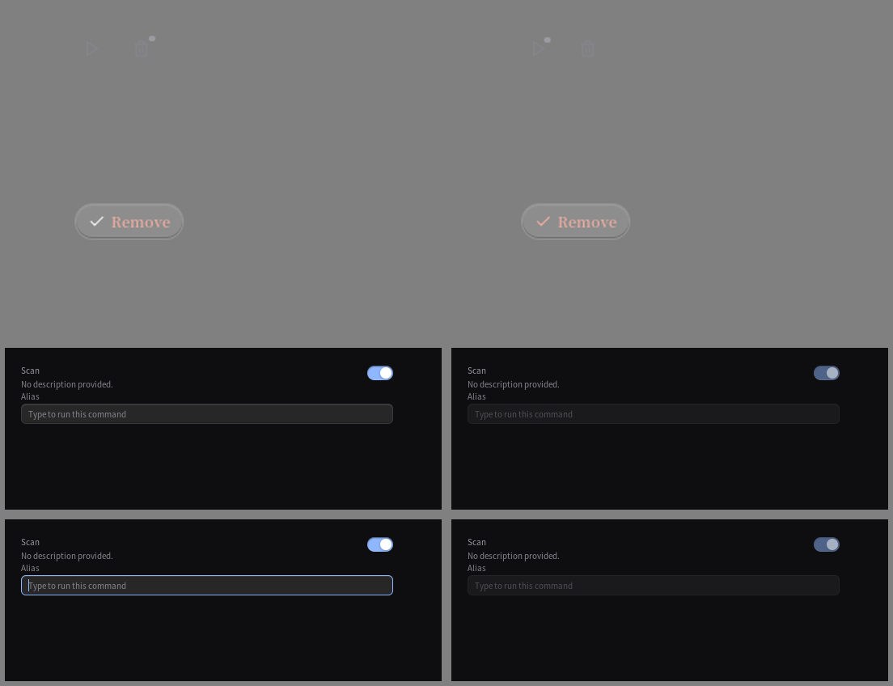

# P13-gz · 设置控件的可用状态与动作归属

起点 `b5073966`，分支 `mygo-rewrite`。本报告随每批修复增量更新。

开工树干净，pull --ff-only 已是最新。done.log 与 stash-backlog 在当前环境不存在；收尾创建 done.log。
禁用胶囊重测：浅色 face/crown/shade 238/238/231；深色 26/26/23，与既有契约一致，未重复计修复。

## stash 清点

任务书的 stale-kill 已由 P13-gq / P13-gy 归档接续。实际剩余八条均非 stale-kill，reverse-check 全部失败；没有静默删除或覆盖现有设计。

| 当前 ref / SHA | 判断 | 处置 |
|---|---|---|
| 0 / 422483b4 | P7 keycap / 旧主题 WIP，非当前设计 | 保留原件 |
| 1 / 8af94a07 | P7 行距 / 滚动边 WIP，后续刻度已有正式 pin | 保留原件 |
| 2 / 7e4aa710 | 卸载布局与 scratch 草稿 | 保留原件 |
| 3 / 1e3aec94 | 旧数字框 / 透镜草稿 | 保留原件 |
| 4 / 363f5a42 | P7 确认带与快捷键草稿 | 保留原件 |
| 5 / 9b8ce23c | P7 快捷键拒绝反馈草稿 | 保留原件 |
| 6 / 90d314b2 | 旧启动器 action bar 草稿，后续键盘合约已定 | 保留原件 |
| 7 / 7a9f6e13 | Tauri release workflow，当前 Go 分支无该路径 | 保留原件 |

独有工作的判断沿用 P13-gq 审核表，没有把 reverse-check 失败误判为可以合入。原件均仍可恢复。

## 已完成（逐条）

1. **恢复状态点错位**：原实现两套主题各有 20 个点像素落在恢复按钮之外 → 移到按钮 Children 中 → 点像素全部归于恢复按钮，按钮布局不变，恢复/删除接线保留。before 原始失败：`resume marker changed 20 pixels, 20 outside its button (20,20)-(45,45)`。
2. **只读会话标题误反馈**：active / exited / 缺恢复回调时标题不能恢复，却把浅色面 229 抬到 205、深色 39 抬到 69 → 用现有 rowFace.Inert 表达不可恢复 → 六组无动作状态保持静息，可恢复的两组仍有 hover 且单击只调用一次。原始失败：`read-only title feedback: available=false rest={229 229 230 ...} hover={205 205 206 ...}`。

首批台账 V 0 / B 0 / S 0（未改旧断言）。截图由新回归用 ui.Tester 生成深浅 before/after。

首批定向实测 **31 PASS / 0 FAIL**，提交 `6b1a7678` 已推送。

3. **外部配置漏锁**：同一集成复检中仍能启动外部配置命令，浅色父行 230→206、深色 39→69 → 入口并入 rowBusy 状态 → 忙态点击回调 0 次、父行像素不变；解除忙态后恰好 1 次。旧实现原始失败：`busy tool configuration launched 1 commands`。
4. **禁用动作的父行误抬升**：Run 已禁用，父行还把按钮旁的浅色 221→198、深色 50→78 → 动作行忙态使用 Inert → 同一取样区域 rest==hover，保留子控件原有禁用淡化与按钮接线。原始失败：`busy action cluster lifted under disabled Run: {221 221 222 ...} -> {198 198 199 ...}`。

第二批定向 **8 PASS / 0 FAIL**，提交 `bfd437fa` 已推送。

5. **卸载动作按压缺面反馈**：静止取样处 hover/press 完全一样（浅 114/114、深 146/146）→ 按下改取 ControlPress，沿用 0.97 缩放与 120ms → 中性/危险 × 深浅四组按下均向地面回落，忙态仍保持禁用。
6. **危险动作图标掉语义色**：确认文字用 Warning，前导确认图标却是默认文字墨（图标区暖色像素 0）→ 图标与标签同取 ink → 深浅都能测到 Warning 图标，禁用仍只淡一次。

开工全量基线已完成：**3530 PASS / 0 FAIL / 2697 测试函数**。最早一遍误用 C locale 的测试已停止，不拿它计基线；中文 locale 完整通过。

第三批定向 **16 PASS / 0 FAIL**，提交 `8d1d072e` 已推送。

7. **命令开关漏锁**：卸载进行中命令开关仍派发 1 次写入 → 复用同行 rowBusy + disabledSwitch → 忙态 0 次写入，解锁后 1 次，开关仍显示原开关状态。原始失败：`busy command switch dispatched 1 writes`。
8. **命令别名漏锁**：复检中别名仍获焦并把 search 写入 debounce 队列 → 使用 rowBusy 锁输入，建面时传 !locked → 不获焦、不生成新草稿、Flush 不派发；解锁后输入正常保存。原始失败：`busy command alias accepted editing: focused=true pending=map[tool\x00scan:{tool scan search}]`。

截至第四批，旧测试断言没有改动，V/B/S 为 0/0/0。8 项跨会话行、集成动作行、命令编辑区、卸载确认组件；未增加页面、依赖或系统。

第四批定向 **12 PASS / 0 FAIL**，提交 `fce19bac` 已推送。四批均按 2 项提交；第一个提交正文没有抄入数字，31 PASS 的原始日志与本报告已补齐，未改写远端提交历史。

## 正式 mutation（额外于八条旧实现红测）

1. **M1** 将新按压臂的 ControlPress 换回 ControlHover，实跑 `TestUninstallActionHasItsOwnPressedFace`：四组红。原始串：`uninstall press did not sink: hover={114 114 114 255 [0 0 0]} press={114 114 114 255 [0 0 0]} ground={128 128 128 255 [0 0 0]}`；深色 hover/press 同为 146。
2. **M2** 删除会话标题的 Inert 条件，实跑 `TestSessionReadOnlyTitleDoesNotInviteActivation`：六组红。原始串：`read-only title feedback: available=false rest={39 39 41 255 [0 0 0]} hover={69 69 71 255 [0 0 0]}`。

每次从备份恢复后执行 `md5sum -c`，两文件均 OK：settingsui.go `e05a7dbb55761aa74b97c551fb45e32d`；uninstall.go `3ecabb619326e311e1588ed33ca80600`。随后 touch 并非缓存重跑新增场景，**16 PASS / 0 FAIL**。未添加 Skip、容差或删弱旧断言。

## 图与两轮复核

32 张原始 PNG（8 项 × 深浅 × 前后）及对照板已保存到本轮目录；标准副本同时是 `/tmp/floter-P13-gz-<表面>-<light|dark>.png`。由 ui.Tester 软件渲染，没有声称做过原生窗口或三平台真机验收。

| 证据 | 浅色 | 深色 |
|---|---|---|
| 会话页，左前右后 |  |  |
| 控件，左前右后 |  |  |

**亲眼看到的变化**：会话整行的无效悬停带消失，标题与行高相同；恢复点从删除图标侧移到播放图标右上；确认图标从普通墨变成与 Remove 相同的警告墨；命令开关淡化后仍是开启位置，别名没有蓝色焦点环且顶边熄灯。恢复点另存 4× 无插值局部核对，位置与图标没有相交。控件量尺用中灰地面（用于对称比较），真实会话页与命令区使用主题地面。

第一轮四视角问题：艺术——无动作整行抬升抢注意；工程——恢复点父节点错误；任务——禁用遗漏可派发写入；读者——危险图标与文字语义不一致。第二轮按这四类修复后重新出图，控件本体与父行分别复核；没有添加装饰层。

**为什么更轻、更有空间感**：无动作的整行回到静息面，真正可用的按钮承担抬升；按下会沉回一档，标记留在对应控件中。没有增加边框、阴影或玻璃叠层。

## 偷了什么

- craft-loop 菜单 **#4 签名交互**：卸载确认接回 `ControlPress`（浅 0.032、深 0.05），保留 **120ms** 颜色过渡与 **0.97** 缩放。
- **#6 编辑细节**：恢复点保持 `Space(1.25)` 大小与 `Space(0.75)` 偏移，默认主题实际 **4.5px / 2.7px**；归入 **25.2px** 按钮盒内。
- **#12 材质细节**：忙态别名 **1px** Hairline 不动，去掉亮冠线、保留底侧暗线；只用框架 **0.5** 禁用淡化。
- **#3 focus 环**：忙态别名获焦次数与新排队写入均为 **0**，解除后原焦点环和提交回调恢复，未另造焦点样式。
- **#11 图形资产**：复用现有 Check SVG，默认主题尺寸 **12.6px**，将图标从默认文字墨接到 Warning，与标签表达同一个危险动作。

Apple 供体只取单一动作色、1px 边、胶囊语义：转成现有 Warning/ControlEdge 与半高圆角。已有方向优先，不导入网页字体、模糊、980px 字面半径或新资产。

## preflight A / B / C / D2

| 条目 | 结论 |
|---|---|
| A1 渐变 / 纯黑 / 霓虹 / 渐变字 | 通过，没有新增 |
| A2 每轮换非系统字体 | 不采用；项目中文系统字体与既有高度契约优先 |
| A3 斜体 | 通过，没有新增 |
| A4 Hero 居中 | 不适用，原生设置控件 |
| A5 三等分 / 万能卡片 | 通过，无新卡片 |
| A6 假名 / 假统计 | 通过，截图仅是明确的可执行测试夹具 |
| A7 空词 / 感叹号 | 通过，无新产品文案 |
| A8 眉批 | 不适用 |
| A9 H1 行数 | 不适用 |
| A10 网格空洞 | 通过，未改布局尺度，旧几何断言保留 |
| A11 左装饰竖线 | 通过，没有新增 |
| B1 设计读取 / 拨盘 | 通过，2/2/6，沿用现有方向 |
| B2 主题锁定 | 通过，每帧单一主题，深浅分别核验 |
| B3 记忆点 | 可用控件才抬升，状态属于对应动作 |
| B4 动效气质 | 通过，沿用轻量 120ms |
| C1 目的 / 频率 | 通过，键盘路径无新动画 |
| C2 all / ease-in / scale(0) | 通过，没有引入 |
| C3 时长 / 按压 | 通过，120ms ≤300ms，按压面 +0.97 缩放 |
| C4 弹出 origin | 不适用，无新弹出 |
| C5 reduced-motion | 通过，夹具使用 ReduceMotion，保留框架降级 |
| C6 hover 媒体查询 | Web 条件不适用，使用原生框架指针事件 |
| C7 属性 / 布局动画 | 通过，仅接回颜色，不增加布局动画 |
| C8 快速触发 | 通过，复用 transition，不重播 keyframes |
| C9 手势 / 拖拽 | 不适用 |
| C10 Framer Motion | 不适用 |
| C11 逐帧 / 真机 | 悬停与按下分别取稳定帧并作 mutation；未声称真机动画验收 |
| D2-1 中文字体 | 通过，保留系统字体，无字体下载 |
| D2-2 行高 / ≥14px / 字重 | 沿用需拍板：正文 10.8px、Caption 9.9px，不能为通过 skill 擅改高度链 |
| D2-3 中西文与单位空格 | 无新产品文案，沿用 i18n |
| D2-4 标点 / 暗色对比 | 标点不变；没有改既有墨色阶梯，正文对比与字号旧限制保留，不宣称全部达 7:1 |

## 仍待

- 下一轮首选参数运行表单的“输入 → 忙态 → 解除”组合状态，先查 `settingsui.go` 的 `runForm`，目前只作线索，不声称有 bug。
- 本轮阻止的是忙态期间的新输入。忙态开始前已进入 180ms 队列的合法别名仍按既有 Flush 规则写回；取消或延迟这些写入涉及保存语义，记为 176-9 需拍板，不擅改。
- 既有字号 / 36px 行盒 / 140-5 / 138-3 / 138-4 与终端 S1b/S1c/S2 尾继续保留。
- P13-gy 的 runOutputToggle 动态三帧 pin 尚缺，未将测试补齐冒充产品修复。

## 全量门槛

最终以 `LC_ALL=zh_CN.UTF-8 GOMAXPROCS=4`、`-count=1`、20 分钟超时分别跑完 verbose 与普通全量测试：**3546 PASS / 0 FAIL**，测试函数 **2705**（基线 2697）。verbose 计数原始输出为 `3546`，普通运行退出码为 0；两遍都没有缓存复用。

已完成 gofmt 空、Linux/Windows/macOS vet 净、Linux/Windows/macOS build 过；文档更新后 `go test -count=1 ./internal/ci` 通过。早先串联门槛收到 SIGTERM（退出 143）以及默认 10 分钟超时的两次尝试不计入结果，保留日志作为过程记录；最终长跑已在 20 分钟上限内通过。

完整运行发现一个 **S 类**旧结构 pin：`aliasField no longer hands its face to fieldFace/fieldFaceEdge`。产品为了禁用材质将建面移到 aliasFieldLit，旧入口委托它；因此字段 owner 精确改名 aliasField→aliasFieldLit，同时新增旧入口必须调用 `aliasFieldLit(c, value, true)` 的检查，原有材质与数值断言保留。最终台账为 **V 0 / B 0 / S 1**。

此前两遍测试在既有 `TestTheSummonLineStandsOnTheInkLadder` 触及默认 10 分钟上限（基线整个 settingsui 已用 593.514s）。保留断言，最终重跑使用 `-timeout=20m` 并通过；不跳测、不减少场景，超时那两遍不计通过。
