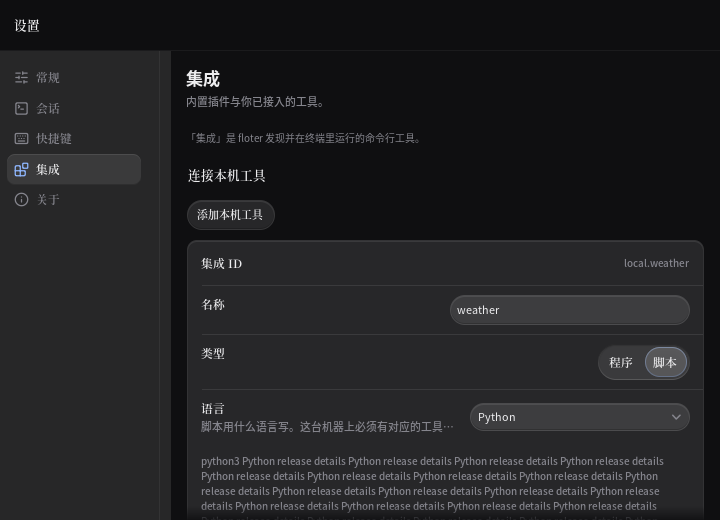
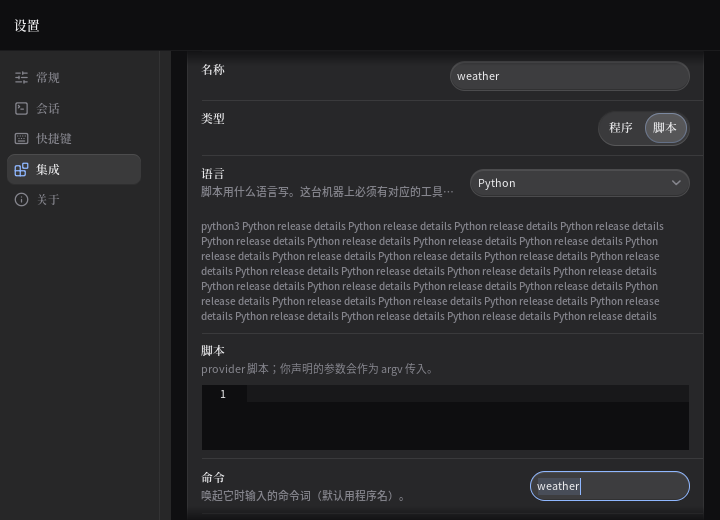
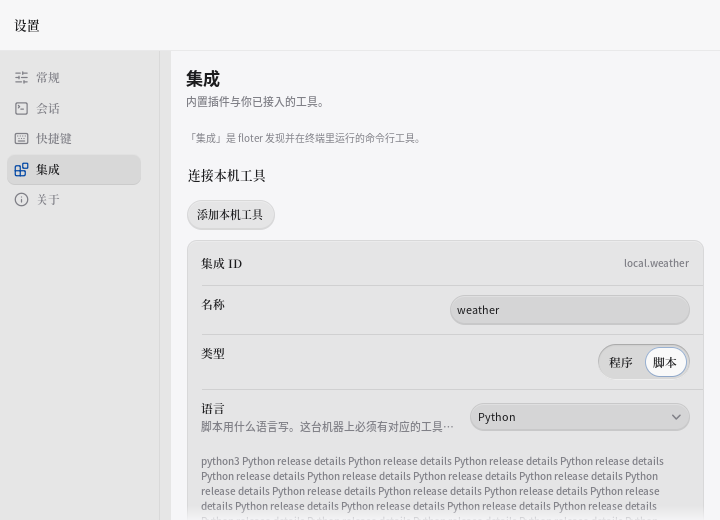
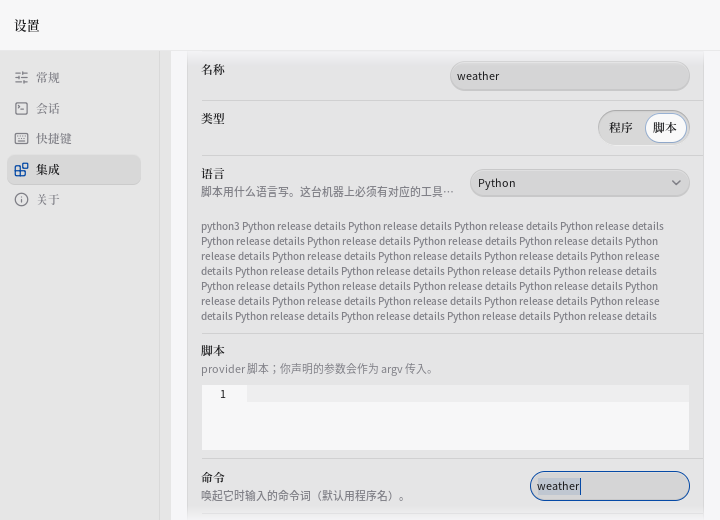

# P13-le · 本地声明编辑器的动态内容与活动出口

已完成八项，跨本地基础字段与参数声明编辑器。最终7528 PASS/0 FAIL/3691函数，较开盘+39 PASS/+8函数；九项统一门槛全绿。抢救稿中的类型出口已接续验证。原执行阶段的失败与纠错记录保留如下。

开盘cbf86dd9，pull已最新，工作区原为空。统一入口已存在且符合本轮需求，直接复用；原任务书进度过期，按P13-ld仍待接续。给定done.log不存在。

## stash清点

旧stale-kill已在P13-gq等轮归档。以下八条早期独立WIP现场reverse-check均1，保留原件；不能将reverse失败直接当作可安全移植的独有功能，旧主题/Tauri链不覆盖当前产品。移植未完成。

| ref | SHA | 判断/处置 |
|---|---|---|
| stash@{0} | 422483b4 | keycap旧WIP，reverse1，保留 |
| stash@{1} | 8af94a07 | settings旧WIP，reverse1，保留 |
| stash@{2} | 7e4aa710 | 卸载布局旧WIP，reverse1，保留 |
| stash@{3} | 1e3aec94 | number字段旧WIP，reverse1，保留 |
| stash@{4} | 363f5a42 | config字段旧WIP，reverse1，保留 |
| stash@{5} | 9b8ce23c | shortcuts旧WIP，reverse1，保留 |
| stash@{6} | 90d314b2 | launcher旧WIP，reverse1，保留 |
| stash@{7} | 7a9f6e13 | Tauri旧WIP，reverse1，保留 |

patch及原诊断写入P13-le/logs。下面仅逐步记录实测。

## 基线与第一批

现场读取P13-ld归档verbose日志为7489 PASS；开盘跟踪文件3683测试函数。不是重新执行一遍完整门槛。首轮复现夹具漏标视口，失败原件保留；修正夹具后的第二次复现八组均红，不再重跑修前组。

1. 命令输入：工具链长提示到达后输入Y=615.3、H=30超出视口底520 → 接入前置内容反馈显现 → 深浅增/撤/再增三阶段均可见，继续输入仍写原命令。
2. 版本输入：同状态Y=519.2、H=30越界 → 接入同一机制 → 深浅三阶段可见，继续输入仍写原版本。

统一入口batch1实测6 PASS/exit0。其余六项测试在修前证据中保留，按所属批次加入仓库，避免中间提交留下已知失败测试。完整门槛与独立变异待轮末，旧V/B/S断言修改0/0/0。

3. 参数身份字段：工具链状态刷新推走仍持焦的标签/ID → 两个出口监听前置反馈 → 各自深浅三阶段几何断言与继续输入归属通过。
4. 参数值字段：占位提示/默认值/前缀同样被挤出视口 → 三出口接入同一反馈机制 → 首次batch2仅3 PASS、其余因Y=471.00006边界失败。执行时未等待结果判断就误提交ae734098，提交正文17 PASS错误，本报告明确纠正。后续修正不能放宽断言；不改参数值、字段种类或输入模型。

batch2唯一重跑17 PASS/exit0。问题在新增夹具使用浮点布局边界：mygo绘制先snap到物理像素，504.00006实际为504。改按框架math.Round比较物理像素（旧B断言零修改，仍不容许丢1px）；同时修正占位字段高度28→真实30。第二次结果才是17 PASS，记录保留先前失败，禁止把首次误写当实测。类型夹具补齐Down→End→Enter既有菜单按键，单独End并非选择。

5. 类型选择：工具链提示变化后仍持焦的选择器越界 → 接入反馈出口。batch3两次均因夹具定位失败：第一次命中同名“类型”标题，第二次错误索引定位“开关”；改为明确的ParamsKindSelect文本，按重试上限未再单独运行。后续恢复组及接续全量均通过：深浅三阶段完整显示，Down/End/Enter把原记录由select改成path。
6. 必填开关：同变化后开关被挤出视口 → 接入反馈出口 → batch3中两次均为3 PASS，Space只切原记录，不误改下一记录。
7. 增删入口：长提示到达后入口仍有焦点但不可见 → 增加/移除入口接入反馈 → batch4及接续全量均通过，Enter分别把记录数从2改成3/1；深浅三阶段入口保持可见。
8. 选项编辑器：长提示到达后原多行输入越界 → 接入反馈出口 → batch4及接续全量均通过，输入仍写原options；固定高度草稿变化不夺手动滚动。

目视深浅图片：修前底部只剩长工具链说明，活动命令在屏外；修后命令输入完整出现在底部，蓝色焦点环四周可见。没有增加卡片、玻璃或阴影。

batch4实测10 PASS/exit0（增删7、选项3）。按小步要求先提交已验证的必填，再提交增删和选项；类型修复留到最终完整门槛通过后单独提交，不将其夹具失败计为成功。

## 实跑变异与恢复

M1撤回命令/版本反馈；M2撤回类型/必填反馈，同时注入、各自独立测试。M1与M2各6 FAIL、0 PASS。原始报错分别为：

`feedback hides command: target={X:529.8 Y:615.3 W:160 H:30} viewport={X:170.6 Y:51.399998 W:549.4 H:468.6}`

`feedback hides kind: target={X:541.8 Y:521.7001 W:0 H:30} viewport={X:170.6 Y:51.399998 W:549.4 H:468.6}`

两文件恢复后md5sum -c均OK，touch后统一restored实测39 PASS/exit0，包括修正夹具后的类型选择。完整门槛已启动一遍；不把mutation的预期失败算门槛失败。

## 偷了什么

从craft-loop.md工艺密度菜单取#3：3px焦点环随控件一起显现，16px滚动边缘加3px环共19px净空；#4：活动出口按已绘制前置反馈变化即时显现，0ms，静态草稿/手动滚动不触发；#6：保持原1px hairline、8px参数板内边距、6px字段间隔，布局增量0。Raycast供体的克制边框、少量强调和分层原则遵循仓库值；未新增五种装饰，用户禁止扩张优先。

这轮更轻、更有空间感：状态提示长短变化时，正在操作的控件仍与滚动边缘留有19px净空，不靠增加卡片或高光来突出它。

## preflight逐项

A1无新增渐变/光晕；A2中文系统字体沿用（中文规则和仓库合约优先于通用换字体）；A3无斜体；A4无Hero；A5无新卡片；A6测试夹具为weather与真实参数；A7无夸张文案；A8无眉批；A9无H1；A10无Bento；A11无选中色条。
B1拨盘2/1/6与任务一致；B2深浅独立；B3核心是原活动输入持续可见；B4即时反馈与轻便方向一致。
C1高频键盘0ms；C2无新增transition/ease/入场；C3按压沿用；C4选择器沿用；C5测试ReduceMotion；C6无新hover；C7无尺寸动画；C8无新keyframes；C9无新手势；C10无Framer；C11用ui.Tester逐帧验证，无新增动效需慢放。
D2-1系统中文字体与zh_CN.UTF-8；D2-2通用14px/1.5行高与现有Caption9.9/正文10.8冲突，仍待拍板；D2-3生产i18n零改；D2-4标点墨色沿用，未重新声称7:1对比。自发现缺陷进入仓库测试及合约，不写全局审美偏好。

四视角复核：视觉上保持现有单层板面；工程上纠正同名标签与像素测量夹具；任务视角恢复继续输入/选择出口；读者视角仍有小字号旧限制，本轮不越权调整。深浅各一组前后原图已目视，PNG由ui.Tester导出到/tmp后归档。其他平台仅交叉vet/build。

## 仍待

1. 下一轮先事件复现前一个参数记录的拒绝提示和选项行数变化，对后一个记录活动输入的影响；本轮仅完成已有前置工具链反馈到本地基础字段/参数编辑器的八项，不冒充已覆盖记录内部反馈。
2. 保存/会话/3秒窗口、字号与行盒、accent禁用、未知多选、字段删除改型、终端S1b/S1c/S2尾仍待拍板。
3. 八条早期独立stash保留；Windows/macOS未原生验收。
4. 批次2误提交是执行偏差；类型夹具两次失败后没有单独重跑，最终由实跑变异恢复组和完整门槛裁决。调用达到效率预算后已冻结范围，其余仅作还原、完整门槛等待与交付收尾。

完整入口第一次后台nohup启动被执行环境清理，停在gofmt且无退出结果、无存活进程。按入口--resume继续，未完成项不视为通过；不是重新跑过已绿门槛。

## 2026-11-09 接续核验

从e03076af接续，pull已最新、工作树干净。按AGENT-NOTES继续P13-le，不新开轮号。
首项核查确认统一入口tools/verify.sh已具备九项门槛、失败上限和十行摘要，直接复用。
抢救稿25d29950的六文件差异已git apply -3成功，接回类型选择器与第八个测试函数；没有改旧V/B/S断言。
本次唯一完整门槛入口为`bash tools/verify.sh P13-le --resume`，摘要落在`P13-le/logs/resume/summary.log`。
先前中断没有留下exit文件，因此本次重新核验全部门槛，不将旧空日志当成成功。

### 接续stash清点（ref为本次开盘值）

| ref | SHA | 判断 | 处置 |
|---|---|---|---|
| stash@{0} | 25d29950 | P13-le独有类型出口、测试与结案草稿；接回前reverse1、接回后reverse0 | 已接入；原对象另存refs/archive/floter/P13-le/完整SHA，门槛通过并提交后drop |
| stash@{1} | 422483b4 | 启动器keycap与旧主题，reverse1 | 保留；未完成移植 |
| stash@{2} | 8af94a07 | 设置行距/滑块与旧pin，reverse1 | 保留；未完成移植 |
| stash@{3} | 7e4aa710 | 卸载对话框及测试，reverse1 | 保留；未完成移植 |
| stash@{4} | 1e3aec94 | 配置数字字段与旧主题，reverse1 | 保留；未完成移植 |
| stash@{5} | 363f5a42 | 配置字段/禁用栏旧实现，reverse1 | 保留；未完成移植 |
| stash@{6} | 9b8ce23c | 自定义快捷键旧接线，reverse1 | 保留；未完成移植 |
| stash@{7} | 90d314b2 | 启动器动作栏旧接线，reverse1 | 保留；未完成移植 |
| stash@{8} | 7a9f6e13 | 旧release工作流，reverse1 | 保留；未完成移植 |

逐项诊断在`P13-le/logs/resume/stash-audit.txt`及对应SHA的reverse.log。八条历史独有稿未宣称清账。
八条历史补丁另做正向git apply --check也全部退出1，明细在同目录forward.log；当前树不能直接接入。
这是尚待逐段迁移的旧工作，不把旧补丁直接覆写当前行为与视觉合约。

接续核对：当前3691测试函数，上轮cbf86dd9实查3683，增8；两组归档变异各6 FAIL，恢复组39 PASS。
settingsui.go与parameditor.go均再次同原变异备份cmp逐字节相等。此次没有重复跑已完成的变异。

### 接续视觉复核

复用同一状态的既有ui.Tester图片，未重复截图。四张原图已从/tmp归档到仓库：

| 外观 | 修前 | 修后 |
|---|---|---|
| 深色 |  |  |
| 浅色 |  |  |

两套修前均只看到底部长提示，命令输入在屏外；修后命令输入与焦点环完整显示。
浅色焦点边也清楚，未增加受光边或修改字号。报告中的19px为16px滚动边缘与3px焦点环的合计净空。

### 最终门槛实测

统一入口exit0：gofmt空；linux/windows/darwin三平台vet与build均exit0；普通与verbose全量均exit0。
verbose为7528 PASS/0 FAIL，测试函数3691（开盘7489/3683）。九项门槛各执行一次、无失败重跑。
本次未重做原执行阶段的两组变异：各6 FAIL，恢复39 PASS，MD5均OK；接续cmp再次确认产品文件未偏移。
旧V/B/S断言修改0/0/0，新增测试函数8，新增Skip0。明细留在logs，十行摘要另存`P13-le/verification.txt`入仓库。
Linux完成ui.Tester事件与视觉复核；Windows/macOS仅交叉vet/build，没有声称原生运行验收。
