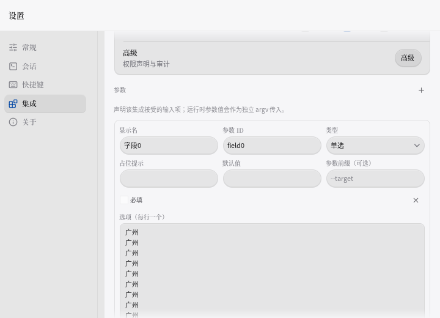
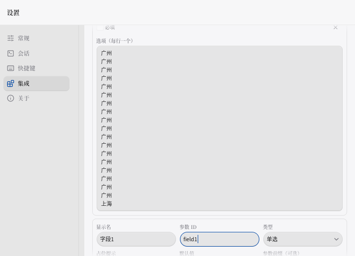
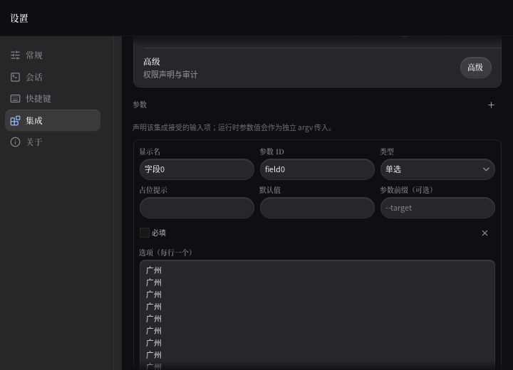
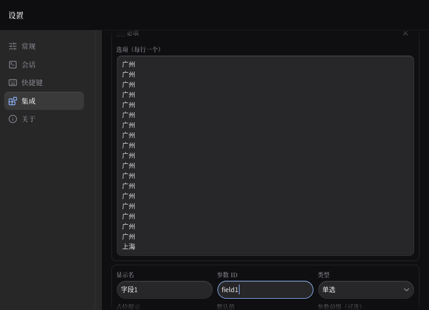

# P13-lf · 参数记录变化后的编辑出口

开盘20eb38e8，工作区干净，pull已最新。P13-le已完成任务书中的旧进度，沿最新仍待继续。统一验证入口已满足摘要/日志/重试上限，直接复用。done.log开盘不存在。

基线：现场读取HEAD归档7528 PASS、跟踪3691测试函数；不是本轮重新跑完整门槛。首次夹具编译失败（ModShift/FindAll并非该版本API）；唯一修前重跑八项全红，原日志保留。修前ID：`preceding options hides id: target={X:364.8 Y:742.80005 W:161 H:30} viewport={X:170.6 Y:51.399998 W:549.4 H:468.6}`。

1. 名称：前记录拒绝/选项增高推走名称 → 监听先前记录提示与选项行数 → 深浅三阶段及原记录继续输入断言。
2. ID：同变化让ID落到Y742.8 → 接入前记录显现 → 深浅三阶段及原ID归属断言。

第一批门槛结果以logs/batch1.log为准；完整门槛和独立变异待轮末。旧V/B/S断言修改0/0/0、新Skip0。

batch1/batch2首跑各4 PASS，产品几何与归属断言通过，但复用滚轮夹具的(600,280)落点处于前一个TextArea内部，其独立滚动并非页面被困。改为(710,280)页面空白边缘；每批仅重跑一次，未在红门槛时提交。

3. 占位提示：前记录提示/选项变化后光标随输入框越界 → 监听前记录反馈 → 实际光标中线定位30px输入框，深浅三阶段和继续输入归属断言。
4. 默认值：前记录增高后默认值不可见 → 同源显现 → 深浅增撤再增三阶段及原默认值断言。第二批结果见logs/batch2.log。

batch1/batch2唯一重跑各10 PASS/exit0，均已按两项提交推送。

5. 前缀：前记录反馈推走命令前缀 → 前缀入口监听同一前记录内容 → 深浅三阶段及继续输入只写原Flag。
6. 类型：前记录增高后仍持焦选择器不可见 → 接入前记录显现 → 深浅几何检查及Down/End/Enter只改原记录种类。第三批结果见logs/batch3.log。

7. 必填：前记录提示/选项变化推走必填控件 → 监听前记录反馈 → 控件行与焦点净空完整显示，Space只改变后一条Required。
8. 多行选项：前记录变高后仍持焦文本区越界 → 接入显现 → 原64px文本区完整可见，继续输入只写原Options。第四批结果见logs/batch4.log。

batch4首跑5 PASS：选项已过，必填夹具误把28px动作整行当作checkbox本体。产品仅承诺活动控件及其焦点环；改为同文案checkbox的实测高度并按既有居中布局定位，像素边缘仍零容差，旧B断言零改动。第四批只重跑一次。

9. 移除：同一记录的移除按钮也依赖前记录位置 → 同族补齐移除入口监听 → 深浅三阶段完整显示，Enter只删后一条，保留原首条。增加入口在所有记录之前，不受前记录高度影响，无需改动。

batch4第二次7 PASS，首条被裁切后测量返回0，夹具需缓存其真实可见高度；不再单跑batch4，最终统一门槛裁决。batch5首次删除后测试探针继续索引第二条panic；增加存活检查，产品删除行为未改。第7/8项暂留最终提交，第9项先独立验收提交。

## 图像复核与工艺

为何更轻/更有空间感：沿用19px出口净空（16px滚动边+3px焦点环），把当前操作对象完整留在视口里，不增加材质、占位或动画。深浅各一张修前/修后，720×520，来自ui.Tester，已亲自目视：修前只看到第一条长选项，修后第二条field1及蓝色焦点边完整出现，下面未激活字段仍自然裁切。没有把整条记录强行塞进视口。

| 主题 | 修前 | 修后 |
|---|---|---|
| 浅色 |  |  |
| 深色 |  |  |

### 偷了什么

- `craft-loop.md`菜单#4滚动显现：一次反馈变化一次显现，动画0ms；不持续追随滚轮。
- 菜单#3焦点环：保留现有3px焦点墨，配16px滚动边形成19px净空，不改颜色或焦点模型。
- 菜单#6编辑细节：沿用8px板内距、6px行距，显现包装净布局增量0。没有把沿用的数值冒充新增设计。
- 两轮制转译为修前事件/图像→产品修复→同状态深浅复核。四视角：视觉上活动字段消失、工程上前记录信号缺失、任务上继续输入无落点、读者上焦点边被裁切，均由同一修复解决。未额外注入网站DNA或凑五种装饰：用户明确已有方向、禁止新增系统，当前是原生行为修复。

### preflight逐项

- A1渐变/霓虹：无新增；A2字体：沿用系统中文（中文专项与用户合约优先，通用“非系统字体”不适用）；A3斜体：无；A4 Hero：表单无Hero；A5卡片：既有记录板数量不变；A6假数据：截图使用测试记录，未当生产数据；A7夸张文案：无；A8眉批：无新增；A9标题：既有短标题；A10 Bento：无；A11装饰竖线：无。
- B1方向/拨盘：符合低变化、无动效、既有密度；B2明暗：分别独立；B3记忆点：当前编辑出口稳定可见；B4气质：即时反馈与紧凑表单一致。
- C1高频键盘：0ms；C2禁用动画模式：无新增；C3时长/按压：显现0ms，原按压保留；C4浮层起点：未改；C5减弱动效：事件夹具ReduceMotion开启；C6悬停媒体条件：原生控件，无CSS；C7几何动画：无；C8快速触发：不新增重播动画；C9手势：未改；C10 Framer：不适用；C11慢放：无新增动画可抽查，不冒充已测。
- D2字体栈：沿用系统中文；字号≥14px/行高≥1.5/仅400/500/600：既有Caption9.9与正文10.8及其他权重仍待用户拍板，本轮不擅改；中西空格与标点：产品文案零改动；暗色7:1：本轮未重新测色，不声称通过通用7:1门槛。原生Linux图像已验，Windows/macOS仅交叉门槛。

## stash清点

现场八条reverse-check均exit1，补丁与诊断分别写盘；未静默丢弃。它们是早期独立WIP，不是本轮抢救稿。旧设计/旧Tauri/未验证工作尚未移植，不能把reverse失败等同可直接合入。

| ref | SHA前缀 | 判断 / 处置 |
|---|---|---|
| stash@{0} | 422483b4 | keycap旧WIP；reverse1，保留 |
| stash@{1} | 8af94a07 | settings旧WIP；reverse1，保留 |
| stash@{2} | 7e4aa710 | 卸载布局旧WIP；reverse1，保留 |
| stash@{3} | 1e3aec94 | number字段旧WIP；reverse1，保留 |
| stash@{4} | 363f5a42 | config字段旧WIP；reverse1，保留 |
| stash@{5} | 9b8ce23c | shortcuts旧WIP；reverse1，保留 |
| stash@{6} | 90d314b2 | launcher旧WIP；reverse1，保留 |
| stash@{7} | 7a9f6e13 | Tauri旧WIP；reverse1，保留 |

## 变异实跑

M1撤销名称/ID前记录信号：10 FAIL/0 PASS；原报错`preceding refusal hides label: target={X:364.8 Y:492 W:161 H:30} viewport={X:170.6 Y:51.399998 W:549.4 H:468.6}`。`product.md5`逐字节还原OK，touch后10 PASS。

M2撤销必填/选项/移除前记录信号：15 FAIL/0 PASS；原报错`preceding refusal hides remove: target={X:533.8 Y:494 W:161 H:28} viewport={X:170.6 Y:51.399998 W:549.4 H:468.6}`。`product-M2.md5`逐字节还原OK，touch后用唯一完整门槛复验。M1备份处于第7/8项接回之前，M2备份为最终产品，各用自己的MD5，未相互覆盖。

旧V/B/S断言修改0/0/0；测试函数只增不减，新增t.Skip为0。最终产品普通全量test已exit0，确认第7/8项及夹具修正通过；verbose计数与三平台build仍在统一入口内继续。

## 仍待

1. 下一轮先复现前记录选项在行数不变但长行自动折行时，对后记录活动出口的影响；本轮钉换行数与拒绝提示，未将未复现的折行路径冒充完成。另检查参数编辑器下方现有动作在同变化时的出口。
2. 字号/行盒、accent禁用、未知多选、保存期间草稿、字段删除改型焦点、终端S1b/S1c/S2尾继续待拍板；3秒窗口、保存和会话语义不改。
3. 八条历史WIP移植未完成；其他平台未运行原生GUI。
