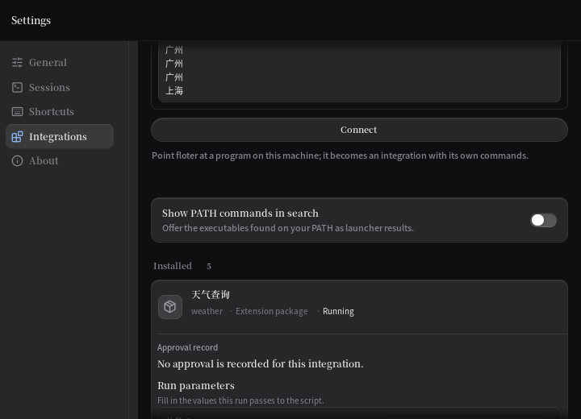
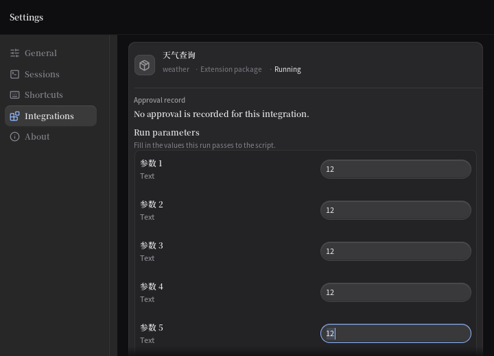
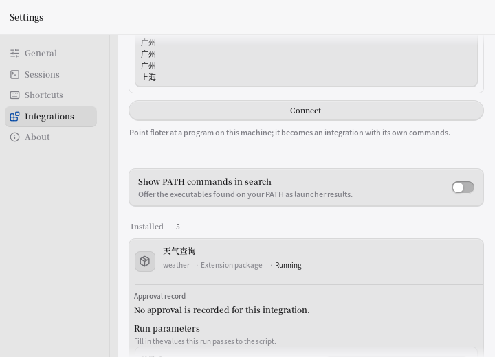
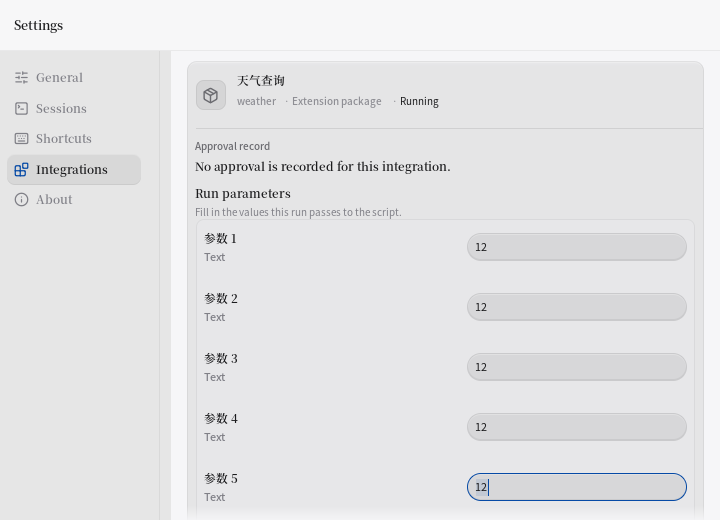

# P13-lg · 参数编辑器下方的活动出口

开盘：e3f067f7，工作树干净，pull已最新。基线读取HEAD日志7573 PASS/3700函数。统一验证入口已存在，第一步核对后复用。done.log在本机不存在，收尾新建。

自动折行线索不成立：当前TextArea外部高度按段落数；测试保留负例。选题转为参数提示/段落变化向下方运行与配置组件传播，详见spec。旧V/B/S修改0/0/0，不新增Skip。

stash逐条reverse-check均1，SHA与上轮一致，保留独立旧WIP；没有将reverse失败误判为已覆盖，也未丢弃。历史移植未完成，本轮不声称完成。

| ref | SHA | 判断/处置 |
|---|---|---|
| stash@{0} | 422483b4 | keycap旧WIP，reverse1，保留 |
| stash@{1} | 8af94a07 | 设置旧WIP，reverse1，保留 |
| stash@{2} | 7e4aa710 | 卸载旧WIP，reverse1，保留 |
| stash@{3} | 1e3aec94 | number字段旧WIP，reverse1，保留 |
| stash@{4} | 363f5a42 | config旧WIP，reverse1，保留 |
| stash@{5} | 9b8ce23c | shortcuts旧WIP，reverse1，保留 |
| stash@{6} | 90d314b2 | launcher旧WIP，reverse1，保留 |
| stash@{7} | 7a9f6e13 | Tauri旧WIP，reverse1，保留 |

## 逐项交付

共享根因是编辑器计算了preceding，却未传入下方integrationLead。本轮一次传播该信号，修复下列八个可独立验收出口；未为拆提交复制八套状态。

| 项 | 现象 → 改动 → 验证 |
|---|---|
| 1 运行文本 | 提示/段落增撤后输入框出屏 → 接通前置反馈 → TestParamDownstreamInput几何及输入24仍写p4 |
| 2 运行开关 | 焦点还在但开关出屏 → 同源反馈显现 → TestParamDownstreamSwitch几何及Space仅切p4 |
| 3 运行选项 | 选项被挤出视口 → 同源反馈显现 → TestParamDownstreamSelect几何及Right选南方 |
| 4 运行取消 | 取消键出屏 → 同源反馈显现 → TestParamDownstreamCancel，Enter关闭原表单且答案12保留 |
| 5 配置字段 | 配置5出屏但仍接收输入 → 同源反馈显现 → TestParamDownstreamConfig，continued只写c4 |
| 6 恢复默认 | 默认按钮随上方记录位移出屏 → 同源反馈显现 → TestParamDownstreamDefaults，c0恢复stored |
| 7 配置复制 | 复制键有焦点但被裁 → 同源反馈显现 → TestParamDownstreamCopy，原ID与dirty草稿只传一次 |
| 8 配置导出 | 导出键有焦点但被裁 → 同源反馈显现 → TestParamDownstreamExport，不误调用复制，原草稿只传一次 |

首次复现夹具错误为TextArea的Tab缩进拦截，修为先到达下方控件再打开本地表单；第二次真实复现56 FAIL/0 PASS，没有第三次复现重跑。修后同组56 PASS/0 FAIL。所有旧断言不变，新增8测试函数；新测试另含同段落长行内部折行不夺手动滚动的负例。

深浅4张PNG在P13-lg/images。已目视：修前只有运行标题、参数5完全不在屏内；修后参数5及输入12、整圈焦点边出现在底部净空内。四视角：艺术上沿用既有材质；工程上修屏外焦点；任务上保留原编辑归属；阅读上原字号仍偏小，待拍板而非擅改。

| 外观 | 修前 | 修后 |
|---|---|---|
| 深色 |  |  |
| 浅色 |  |  |

## 偷了什么 / preflight

craft-loop #3：既有3px焦点环完整露出；#4：单次滚动显现19px净空、0ms；#6：沿用8px记录内距/6px行距。为什么更轻：用已有空间带保护活动墨，不加边框或玻璃层。功能修复不按菜单硬凑五种装饰；站点DNA/四方向预览不适用于本轮已定方向，按用户指令走打磨路径。

A逐项：无新渐变/纯黑/霓虹；字体沿用中文系统字体（通用换字体条不适用）；无斜体；无Hero；无新卡片；无伪造产品数据；无新增营销文案；无新增眉批/H1/Bento/竖线装饰。
B逐项：与2/1/6读取一致；深浅各自单一主题；识别点是当前编辑仍可见；0ms符合键盘操作气质。
C逐项：显现有任务目的且0ms；无transition/ease/scale/fade；未加动效并保留按压反馈；浮层原点未改；ReduceMotion夹具已启用；hover原行为不变；未新增布局动画。
D2逐项：系统中文字体保留；正文≥14px/行高≥1.5/字重400-600与旧Caption9.9、Body10.8及580冲突，继续需拍板；中西文空格/标点没有新文案；暗色7:1未重测，本轮不改墨，不能声称该项达标。约束继承，不静默略过。

## 变异与验证

M1删除拒绝提示信号，32 FAIL/0 PASS，原报错：`feedback reflow hides active outlet "参数 5": target={X:204.8 Y:504 W:249.99998 H:16} viewport={X:170.6 Y:51.399998 W:549.4 H:468.6} focused=true`。MD5还原OK，touch后32 PASS/0 FAIL。

M2删除选项段落信号，32 FAIL/0 PASS，原报错：`feedback reflow hides active outlet "参数 5": target={X:204.8 Y:754.80005 W:0 H:0} viewport={X:170.6 Y:51.399998 W:549.4 H:468.6} focused=true`。MD5还原OK，touch后32 PASS/0 FAIL。原始日志、exit和MD5结果均在P13-lg/logs。

产品bee6e414已推送；完整门槛经tools/verify.sh完成：**7629 PASS/0 FAIL/3708函数**（基线7573/3700，+56/+8），failed_gates=0，verify.exit=0。gofmt空，三平台vet/build净，普通与verbose全量均exit0。九项摘要在`P13-lg/logs/verify-summary.txt`，完整原始日志随本报告归档。首次定向调用误写tools.verify.sh导致exit127，未执行任何验证，随即纠正路径；未把它计作测试结果。

后台nohup启动被外层中断：未生成任何门槛exit或摘要，进程已不在，不能算门槛通过。随后用同入口--resume和持久终端session接续；gofmt第二次尝试通过，其余门槛首次执行。并非把失败日志覆盖成通过，已有attempt目录保留。

提交纪律偏差：八个出口共用同一个缺失信号，产品与八项验收一次提交，未满足每1–2项一次提交的字面要求；没有为凑批次复制状态或拆分单行修复。全量结果将另作结案提交。历史stash移植也未完成，均明确保留。

## 仍待

1. 下一轮先事件复现本地参数编辑器下方自己的提交按钮，在参数拒绝提示和选项段落增撤时的可见性；其次检查下方宿主配置/运行提交入口。自然通过不算新修复，本轮不声称这些额外动作已单独验收。
2. 字号/行盒、accent禁用、未知多选、保存期间草稿、删除/改型焦点、终端S1b/S1c/S2尾继续待拍板；不改变3秒窗口或保存语义。
3. Linux ui.Tester事件和深浅图已验；其他平台仅交叉vet/build。八条旧WIP移植待续。
