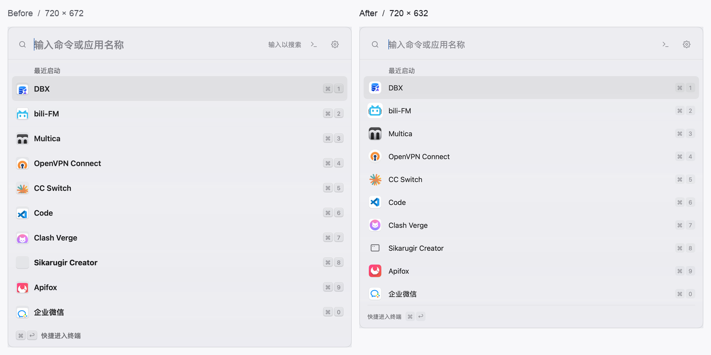
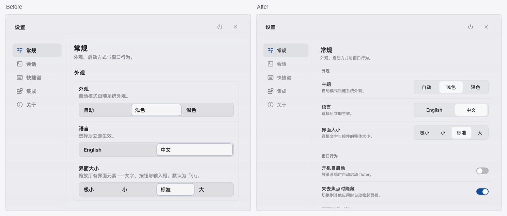

# Raycast 风格与透明材质调整

本轮按当前需求调整原生 Go/mygo 界面：减少刻意压缩的控件，增加留白，让窗口的液态玻璃贯穿内容区。这里的尺寸与背景规则取代旧轮次文档中冲突的紧凑尺寸、实色内容底板和选中行凸边要求。

## 视觉与操作

- 字阶在标准缩放下为 12 / 14 / 15 / 16 / 18 / 22；搜索框和设置页标题使用 18px 档。沿用系统字体与现有等宽字体。
- 主要按钮、图标操作、文本框、选择器和分段控件至少 36px 高；侧栏条目至少 40px。
- 启动器结果行按 48px × 界面缩放计算，单行与双行内容使用相同行高。设置行至少 60px，会话行至少 68px。
- 设置行上下内边距为 12px × 缩放，组间距为 28px × 缩放。操作较多时允许换行；换行容器保留行内垂直对齐。
- 启动器标题使用 15px 常规字重，选中时保持宽度与字重稳定。32px 应用图标完整显示，去掉外套底板与裁切；缺失图标显示通用应用图形。
- 快捷键图例使用轻薄透明填充，不画凸边、浮雕或额外描边。搜索框移除重复的尾部提示，底部提示使用 12px 辅助文字与细分隔线。
- 分段选择和表单控件统一为圆角矩形。选项文字居中，宽度按实际文字分配，选中项使用中性浅填充和细边；键盘聚焦仍由独立焦点环标示。列表与侧栏选中状态使用中性透明填充，去掉重复凸边。
- 设置正文、侧栏和分组卡不再铺不透明的白色或黑色底板。输入框保留轻薄填充，设置正文移除上下滚动渐变覆盖层；下拉菜单使用浮层材质。
- 配置多选列表提供 132px 视口与至少 36px 的选项行，其余内容在框内滚动。长字体名称在选择器内收口。
- 同步调整启动器窗口高度、分组标题预算、底部状态栏、插件配置高度与终端设置布局。插件文本框的内部编辑器占满字段高度，点击字段留白也能聚焦。

## 截图反馈后的比例修正

用户截图中的问题由搜索字号、标题字重、行高、图标裁切和重复键帽装饰共同造成。调整后的满列表在标准缩放下从 720×672 降到 720×632 DIP，仍显示十条应用及底部提示；点击按钮仍至少 36px。



上图两边均为 mygo 渲染器，使用同一组本机应用图标、标准界面缩放与按住 ⌘ 的状态，并合成在相同中性背景上。完整浅色、深色及混合双行内容预览：

- [浅色启动器](ui-redesign/launcher-light.png)
- [深色启动器](ui-redesign/launcher-dark.png)
- [单行与双行混合列表](ui-redesign/launcher-mixed.png)

预览不包含操作系统的桌面模糊或折射。以下命令按实际计算的窗口高度生成 Retina 预览，仅在显式开启时读取本机应用图标，不启动应用：

```sh
LC_ALL=zh_CN.UTF-8 FLOTER_LAUNCHER_PNG=/tmp/floter-proportions-final \
  go test ./internal/shell -run '^TestLauncherProportionPreview$' -count=1
```

## 设置页截图反馈后的重排

原有设置页把大标题、粗说明、满行分段控件和分组外框叠在一起，标准 720×580 窗口首屏几乎只显示三个选项。本次将短选项改为左侧名称与说明、右侧选择器；较窄窗口或长翻译时整组换行，不压缩文字。

- 页面标题 18px/600，行名称与侧栏 14px/400，辅助说明及组标题 12px。集成列表和关于页同步采用这套层级。
- 侧栏以 152px 为基础，按翻译后的名称和界面缩放扩大，避免英文 Integrations 被截断。
- 正文内边距 24px，组间距 28px，普通行保持至少 60px，按钮与分段选项保留至少 36px 点击高度。
- 分组去掉外框和底板，仅用细分隔线组织行；移除顶部和底部的渐变覆盖层。
- 选择器以 220px 标准宽度为基础，按文字实际长度扩展。英文 Standard / Liquid Max 与中文液态拉满完整显示，改变选中项不会改变边框占位。
- 缩短界面大小与玻璃说明，去掉重复的“外观”行名。



两边均使用同一 mygo 渲染器、中文、标准界面缩放、47% 背景透明度与 720×580 DIP 窗口。左侧为用户本次反馈时的实现，右侧为本轮重排；图片合成在相同中性背景上，不包含操作系统桌面模糊或折射。

- [浅色设置](ui-redesign/settings-light.png) / [深色设置](ui-redesign/settings-dark.png)
- [浅色集成列表](ui-redesign/integrations-light.png) / [深色集成列表](ui-redesign/integrations-dark.png)

重新生成五个设置页面、深浅外观、720/620px 宽的 20 张 Retina 预览：

```sh
LC_ALL=zh_CN.UTF-8 FLOTER_SETTINGS_PNG=/tmp/floter-settings-final \
  go test ./internal/shell -run '^TestSettingsProportionPreview$' -count=1
```

可用 `FLOTER_SETTINGS_LANGUAGE=en`、`FLOTER_SETTINGS_SCALE=large` 检查英文大字号；`FLOTER_SETTINGS_BOTTOM=1` 检查页面底部。上一轮全局调整的历史预览保存在 [comparison.png](ui-redesign/comparison.png)。

## 原生窗口最底层透明修正

用户反馈背景仍像实色底板后，增加了真实 AppKit 窗口检查。原有根节点、NSWindow 和根视图的背景 alpha 已为零；问题在窗口后方的材质：标准液态档使用 `NSVisualEffectView / under-window`，增强液态档使用偏厚的 `sidebar`。前景 PNG 的 alpha 正确无法证明这一层透明。

- macOS 两个液态档改用 `VibrancyGlassClear`，在 macOS 26+ 对应 `NSGlassEffectView` 的 clear 样式；更早系统由框架回退至 HUD 材质。
- 浮动面板通过框架的 `SetActiveAppearance` 保持清透外观，避免另一个应用处于前台时被系统加重磨砂。该接口依赖框架封装的 AppKit 私有能力；若未来系统移除它，框架会退回系统默认外观。
- 移除原有 under-window/sidebar 的 22%/34% 固定补偿，液态档低端透明度随滑块连续变化。原生玻璃对背景的折射和色彩响应不再冒充一个可精确计算的固定 alpha。
- 保留显式磨砂档和关闭档的独立行为。

已在 macOS 27.3 运行原生检查：修复前可复现旧磨砂视图，修复后确认 NSWindow 与根视图无实色底、原生 clear 玻璃存在、面板使用激活外观，关闭和来回切换档位均正常。五个设置页的渲染检查也覆盖 10%→25%→75%，防止低端滑块再次出现不变化的区间。

```sh
FLOTER_NATIVE_GLASS_TEST=1 go test ./internal/shell \
  -run '^TestNativeGlassBackground$' -count=1 -v
```

原生检查仅创建隐藏窗口，使用内存设置，不改动用户配置。[修复前后原生检查日志](ui-redesign/native-glass-verification.txt)。玻璃映射、主题、CI 合约、窗口透明度定向测试及本机构建、静态检查均通过。

## 验证记录

设置页重排后的检查：

- `internal/control`、`internal/theme`、`internal/ci`、`internal/i18n` 整包通过。
- 中英文 × 四档字号 × 620/720px 窗宽的选项边界、完整标签、侧栏文字和至少 36px 点击高度检查通过。
- 设置写入、主题/玻璃/字号/语言切换、侧栏导航、页面滚动、分段控件的键盘操作、配置字段刷新与草稿身份通过定向检查。
- 常规、会话、快捷键、集成、关于页完成深浅色与窄窗截图检查；五页内容区 alpha 随透明度设置变化的检查通过。
- 本机 `go build ./...`、`go vet ./...`、格式和 diff 空白检查通过。

截图反馈后的比例修正已完成 27 项启动器定向检查，包括四档缩放、十条结果与底栏、数字快捷键、方向键、点击启动、图标与缩略图、文字截断和输出列表边界。主题与 `internal/ci` 整包通过；窗口高度、共享页头与透明度检查通过；本机构建与 `go vet ./...` 再次通过。以下是前一轮整体调整的验证记录。

- 主题、共享控件、插件配置模型及 `internal/ci` 测试通过。
- 四种界面缩放下的最小命中区域、按钮点击、文字输入、分段切换与长下拉值的边界检查通过。
- 插件输入提交、拒绝写入后的重试、字段重排与配置刷新时的草稿保留、复制反馈不挤动相邻按钮、设置值垂直对齐通过针对性复测。
- 多选列表内部滚动、操作忙碌锁定、十条启动器结果、底部操作栏与状态栏、输出列表分页与折边、终端数值读数通过针对性复测。
- 五个设置页面在浅色/深色下的内容 alpha 随 25%→75% 透明度设置改变，像素回归检查通过。
- `go vet ./...`、本机 `go build ./...`、Linux 与 Windows 交叉构建通过；格式和 diff 空白检查通过。

全量 `go test -count=1 ./...` 已执行，但没有全部通过。未修改的 HEAD 在六个主要 UI 包中已有 133 个顶层测试失败；本轮全量运行还报告旧字号/行高/胶囊形状/实色背景/凸边的视觉断言差异，以及 macOS 的 XDG、符号链接与 Unix socket 路径限制等环境问题。全量运行后发现的输入框命中、行内对齐、复制反馈和配置窗口预算问题已修复并定向复测；没有将旧视觉测试批量跳过或声称全量通过。原生窗口的系统材质仍需实际运行应用观察。
